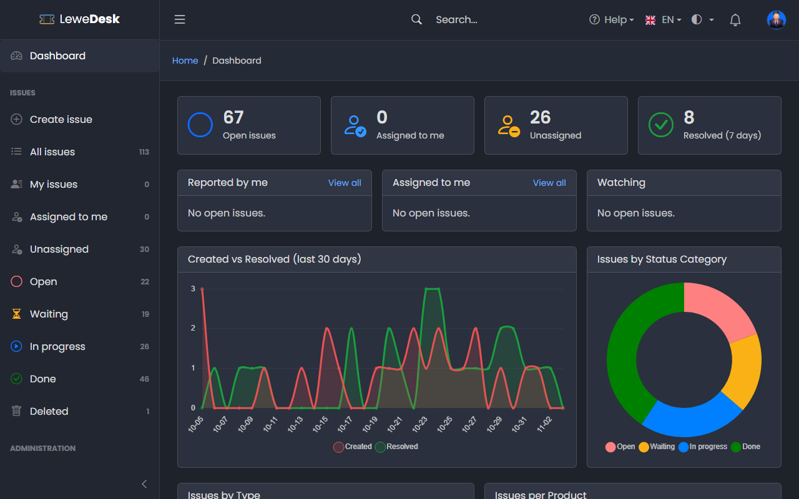

# LeweDesk

<figure><figcaption></figcaption></figure>

LeweDesk is a web-based issue tracker (ticket system) for customer support. It gives customers one central place to report problems, ask questions and request improvements, and it gives your support team the tools to work through them.

## Features

* **Issue tracking** with types, status, resolutions, products, versions and tags
* **Status workflow** through actions: Respond, Resolve, Close, Reopen, Assign, Watch and more
* **Comments** with Markdown, inline images and internal notes that only the support team can see
* **Attachments** (txt, md, pdf, zip, gif, jpg, png) with size and count limits
* **History** of every change on an issue
* **Search and quick views** such as _My issues_, _Assigned to me_, _Unassigned_ and one view per status category
* **Access control** with roles, groups and permissions. Each issue is _Public_, _Registered_ or _Reporter only_
* **Notifications** in the application and by email, configurable per user and event
* **Dashboard** with statistics and charts
* **Spam protection** with hourly limits and a honeypot field
* **Dark and light mode** and two languages (English and German)

## Who is this manual for?

| You are...                                  | Start here                                       |
| ------------------------------------------- | ------------------------------------------------ |
| A customer or colleague reporting issues    | [Quick Start Guide](quick-start-guide.md) and [User Guide](user-guide/README.md) |
| A member of the support team (Agent)        | [User Guide](user-guide/README.md), especially [Issue Actions](user-guide/issues/issue-actions.md) |
| An administrator                            | [Installation](installation.md) and [Administration](administration/README.md) |


What you can see and do depends on your role and the permissions granted to it. If a menu entry or button described in this manual is missing for you, ask your administrator.

