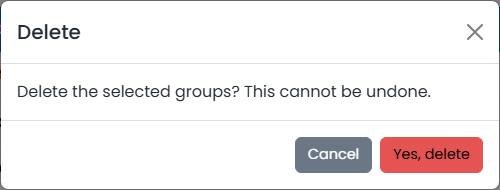

# Administration

The **Administration** section of the sidebar is only visible to users who hold the corresponding permissions. By default these belong to the role _Administrator_.

The pages are grouped in two areas:

* [System](system/README.md): users, roles, groups, permissions and the system settings
* [Issues](issues/README.md): the lists that structure issues: issue types, products, status, status categories, resolutions and tags

In addition, [Housekeeping](housekeeping.md) describes the automatic cleanup that runs in the background.

## How the list pages work

All list pages work alike:

* Click a row's checkbox to select it. **Edit** opens the selected record, **Delete** removes the selected records after a confirmation.
* **Add** (where available) opens an empty form.
* Use **Search** to filter the table, **Show entries** to set the page size and the column headers to sort.

<figure><figcaption></figcaption></figure>
