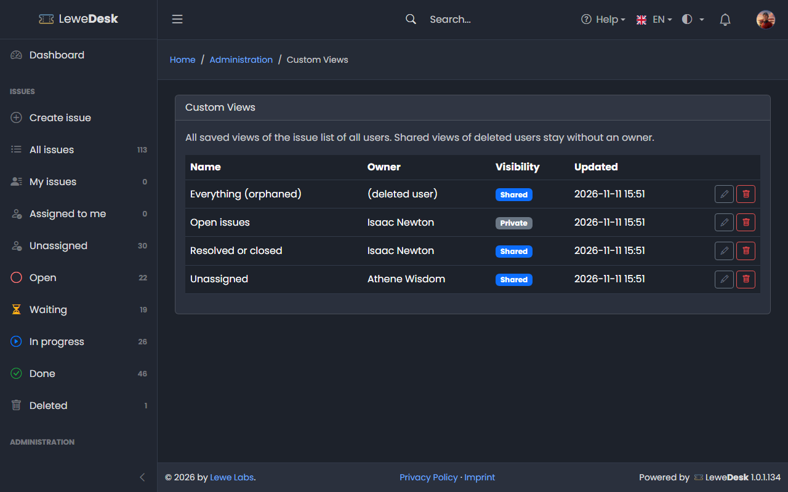

# Custom Views

<figure><figcaption></figcaption></figure>

Custom views are saved filter combinations of the issue list (see [List Issues](../../user-guide/issues/list-issues.md#custom-views)). Users manage their own views in their [profile](../../user-guide/profile.md#custom-views-tab). This page is for administrators: it lists the views of all users and requires the permission `manage_custom_views`.

## Columns

| Column     | Description                                                                                         |
| ---------- | --------------------------------------------------------------------------------------------------- |
| Name       | Name of the view                                                                                    |
| Owner      | The user who created the view. _(deleted user)_ for a shared view whose owner was deleted           |
| Visibility | _Private_ (only the owner uses it) or _Shared_ (all registered users can select it)                 |
| Updated    | Date and time of the last change                                                                    |

## Buttons

| Button | Function                                                                                                  |
| ------ | --------------------------------------------------------------------------------------------------------- |
| Edit   | Opens the dialog with the name, the visibility and the eight filters. The owner of the view does not change. |
| Delete | Deletes the view after a confirmation                                                                     |

If a filter value of the view does not exist anymore, the dialog leaves it out. The view is repaired when you click **Save**. Note that the assignee and reporter lists only contain users of issues you may see.

## Deleted users

When a user is deleted, the private views of that user are deleted as well. The shared views stay and have no owner anymore; only administrators can change or delete them.

Creating, changing and deleting a view is written to the [Audit Log](../system/audit-log.md), also when an administrator does it for another user.
