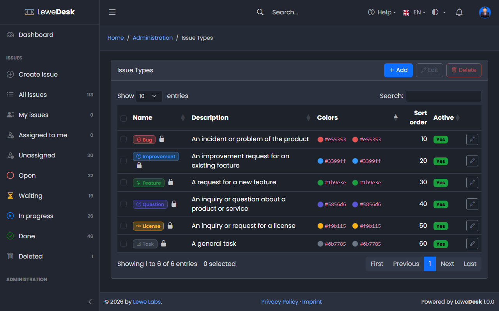
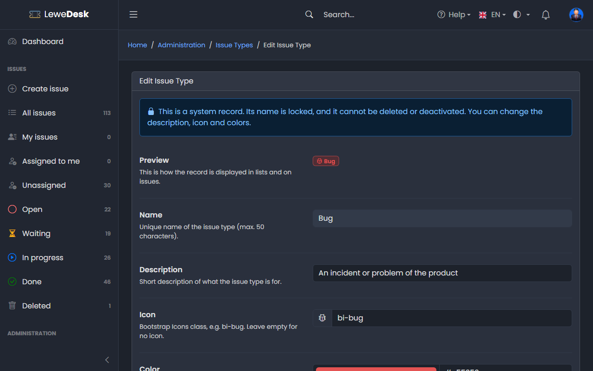

# Issue Types

<figure><figcaption></figcaption></figure>

The issue type says what kind of issue it is. The reporter selects it when creating an issue. Agents can change it on the [Edit Issue](../../user-guide/issues/edit-issue.md) page. Requires the permission `manage_issue_types`.

## System issue types

| Name        | Description                                    |
| ----------- | ---------------------------------------------- |
| Bug         | An incident or problem of the product          |
| Improvement | An improvement request for an existing feature |
| Feature     | A request for a new feature                    |
| Question    | An inquiry or question about a product or service |
| License     | An inquiry or request for a license            |
| Task        | A general task                                 |

## Buttons

| Button | Function                                                                      |
| ------ | ----------------------------------------------------------------------------- |
| Add    | Opens the form to create a new issue type                                     |
| Edit   | Opens the Edit page for the selected issue type                               |
| Delete | Deletes the selected issue types. System issue types cannot be deleted. If issues use the type, you select a replacement. |

## Add and Edit Issue Type

<figure><figcaption></figcaption></figure>

See [common fields](README.md#common-fields). The icon and color of the type are shown in the first column of the issue list.
