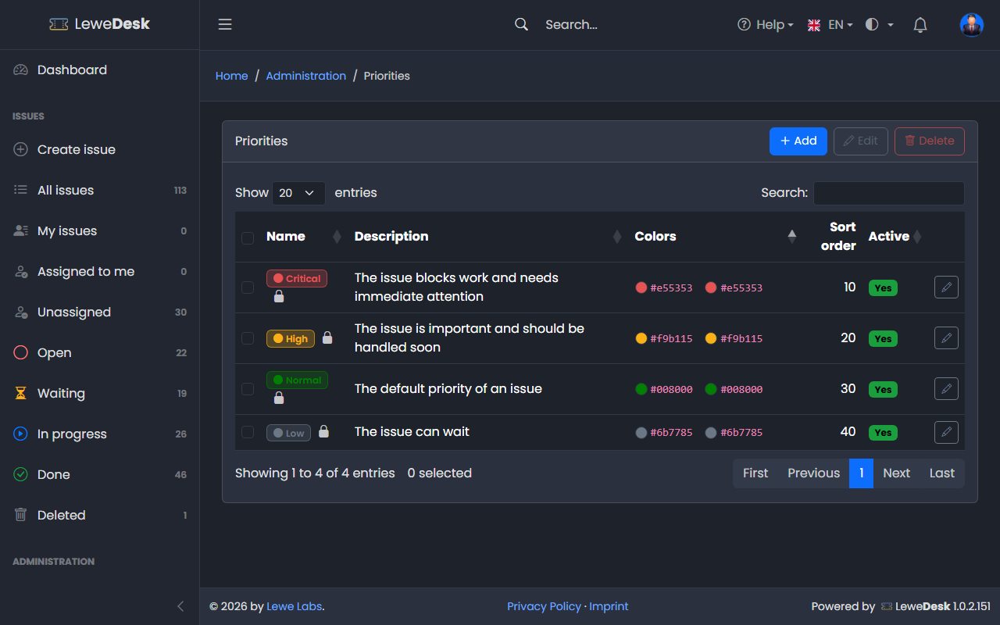
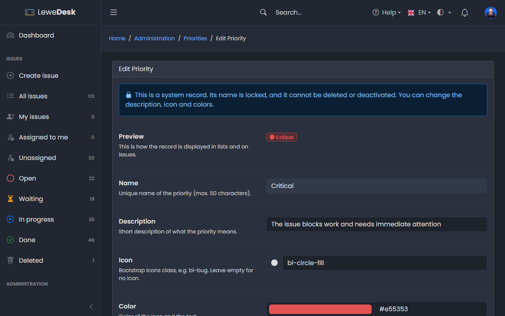

# Priorities

<figure><figcaption></figcaption></figure>

A priority says how urgent an issue is. Every issue has exactly one priority. New issues start with _Normal_ (also the issues that are created by [email](../system/email-to-ticket.md)), and the support team can change it. Requires the permission `manage_priorities`.

## System priorities

| Name     | Description                                          |
| -------- | ---------------------------------------------------- |
| Critical | The issue blocks work and needs immediate attention  |
| High     | The issue is important and should be handled soon    |
| Normal   | The default priority of an issue                     |
| Low      | The issue can wait                                   |

All four are system records. They cannot be deleted, deactivated or renamed, but you can change their description, icon and colors. You can add your own priorities next to them.


The issue list shows the **icon** of the priority in its color, not the name. Move the mouse over the icon to see the name. Choose the colors so that the priorities are easy to tell apart.


## Buttons

| Button | Function                                                                                                    |
| ------ | ----------------------------------------------------------------------------------------------------------- |
| Add    | Opens the form to create a new priority                                                                     |
| Edit   | Opens the Edit page for the selected priority                                                               |
| Delete | Deletes the selected priorities. System priorities cannot be deleted. If issues use it, you select a replacement. |

## Add and Edit Priority

<figure><figcaption></figcaption></figure>

See [common fields](README.md#common-fields).
