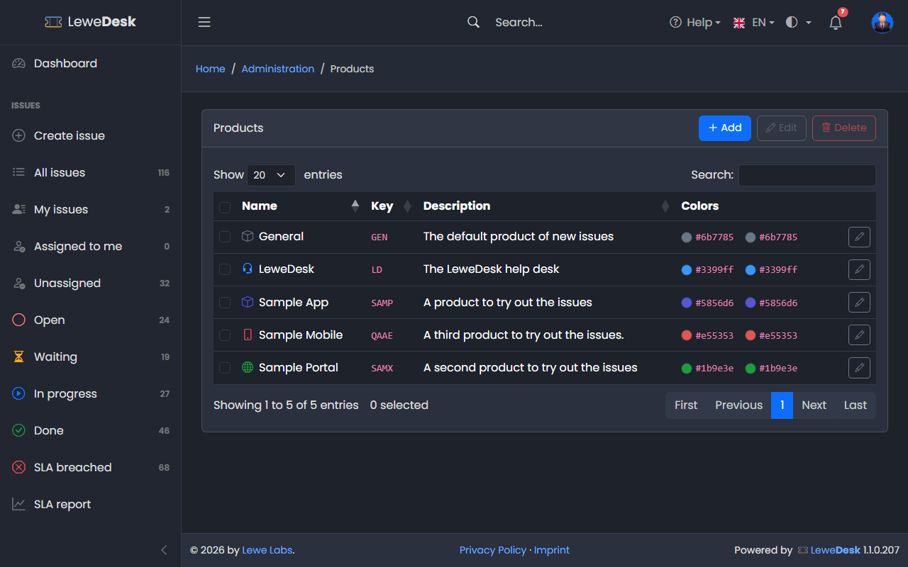
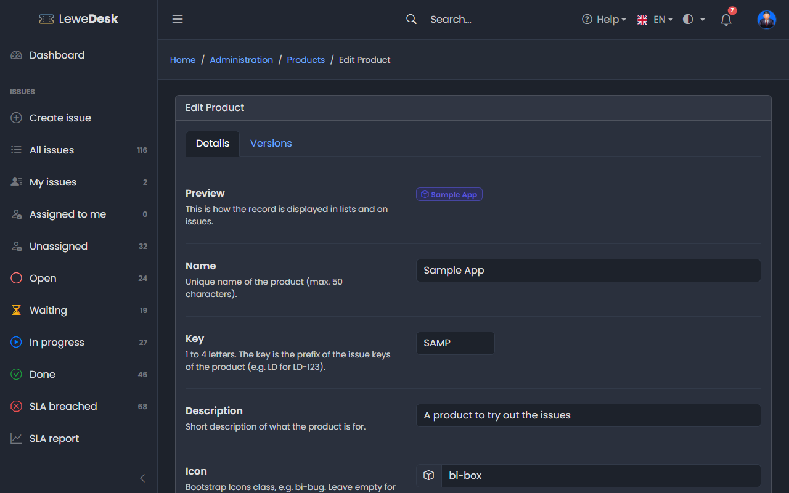

# Products

<figure><figcaption></figcaption></figure>

Products are the things your customers need support for. Every issue belongs to exactly one product. The **key** of the product is the prefix of the issue keys: an issue of the product with the key _LD_ is _LD-123_, and every product counts its own numbers. A product also has **versions**, and an issue can name the version it occurs in and the version that fixes it.

The issue list can be filtered by product, and the dashboard shows the number of issues per product. Requires the permission `manage_products`.

## Buttons

| Button | Function                                                                                                              |
| ------ | --------------------------------------------------------------------------------------------------------------------- |
| Add    | Opens the form to create a new product                                                                                |
| Edit   | Opens the Edit page for the selected product                                                                          |
| Delete | Deletes the selected products. If issues use them, LeweDesk asks which product these issues move to (see below).      |

## Add and Edit Product

<figure><figcaption></figcaption></figure>

| Field            | Description                                                                                       |
| ---------------- | ------------------------------------------------------------------------------------------------- |
| Name             | Unique name of the product (max. 50 characters)                                                   |
| Key              | 1 to 4 letters (A-Z), unique. It is the prefix of the issue keys, e.g. `LD` for `LD-123`. Shown in upper case. |
| Description      | Short description of the product                                                                  |
| Icon             | Bootstrap Icons class, e.g. `bi-box`                                                              |
| Color            | Color of the icon and the text                                                                    |
| Background color | Background color                                                                                  |

The Edit page has two tabs: **Details** (the fields above) and **Versions** (see below).

### Change the key

You can change the key of a product at any time. All issues of the product then show the new key. **The old keys keep working**: links, bookmarks and mails that use `LD-123` still lead to the issue. A key that another product uses, or that an old key of another issue uses, cannot be chosen. LeweDesk warns you before you save a changed key.

## Default product

The setting **Default Product** (Settings, tab Issue Config) names the product of new issues that name none, for example the issues made from mails (see [Email to Ticket](../system/email-to-ticket.md)). Installations start with the product _General_ (`GEN`). The default product cannot be deleted without choosing another default product.

## Delete a product that issues use

A product that issues still use cannot simply disappear, because every issue needs a product. LeweDesk asks you to select a **replacement product**:

* All issues of the deleted product move to the replacement and get **new keys** there (the next numbers of the replacement). Their old keys keep working.
* Their affected and fixed versions are cleared, because versions belong to a product. The versions of the deleted product are deleted with it.
* If the deleted product is the default product, the replacement becomes the default product.

## Versions

The **Versions** tab of a product lists its versions, the newest first (natural order: _1.10_ comes after _1.9_). Click **Add version** or the edit icon of a version. Requires the permission `manage_products` to change, and `view_issue` to read.

| Field        | Description                                                                                          |
| ------------ | ---------------------------------------------------------------------------------------------------- |
| Name         | The version, e.g. `1.2.3`. Unique within the product (max. 50 characters).                          |
| Status       | _Planned_, _In development_, _Released_ or _Archived_                                                |
| Release date | Optional while _Planned_ or _In development_. **Required** once the version is _Released_.         |
| Link         | Optional web address (`http` or `https`), e.g. the release on GitHub                                 |
| Description  | Optional text. It is shown in the [release notes](../../user-guide/release-notes.md).               |

The list shows how many issues have the version as affected version and as fixed version, and a link to the release notes of the version.

When someone creates or edits an issue, the pickers for the **affected version** and the **fixed version** offer the versions of the issue's product, grouped by _Planned_, _In development_ and _Released_. **Archived versions are not offered** for new choices, but they stay visible on the issues that already use them. Use _Archived_ for old versions that nobody should select any more.

### Delete a version

If no issue uses the version, it is deleted at once. If issues use it, LeweDesk asks which version these issues get instead, or **None** to clear the field. The affected and the fixed version of the issues are replaced.


The history of an issue records every change of its product, key and versions, and the audit log records the creation, change and deletion of versions.

