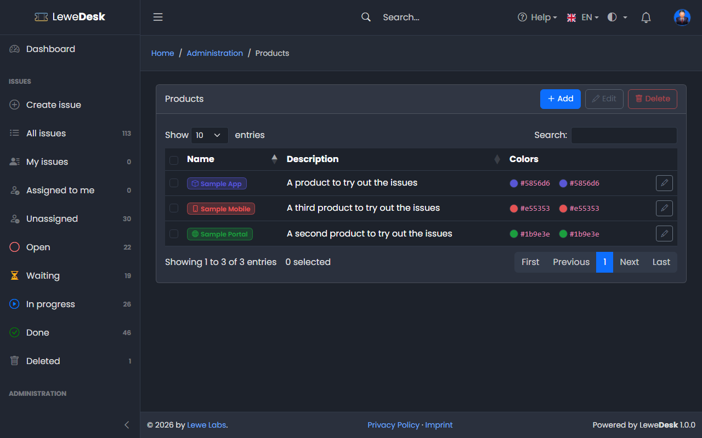
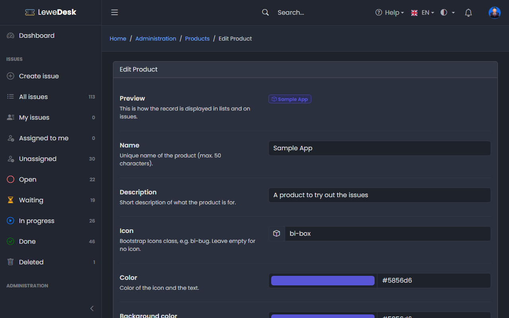

# Products

<figure><figcaption></figcaption></figure>

Products are the things your customers need support for. The reporter can select a product (optional) and enter a version when creating an issue. The issue list can be filtered by product, and the dashboard shows the number of issues per product. Requires the permission `manage_products`.

## Buttons

| Button | Function                                                                           |
| ------ | ---------------------------------------------------------------------------------- |
| Add    | Opens the form to create a new product                                             |
| Edit   | Opens the Edit page for the selected product                                       |
| Delete | Deletes the selected products. The product is removed from the issues that use it. |

## Add and Edit Product

<figure><figcaption></figcaption></figure>

| Field            | Description                                    |
| ---------------- | ---------------------------------------------- |
| Name             | Unique name of the product (max. 50 characters) |
| Description      | Short description of the product               |
| Icon             | Bootstrap Icons class, e.g. `bi-box`           |
| Color            | Color of the icon and the text                 |
| Background color | Background color                               |


The _Version_ of an issue is free text entered by the reporter. There is no list of versions per product.

