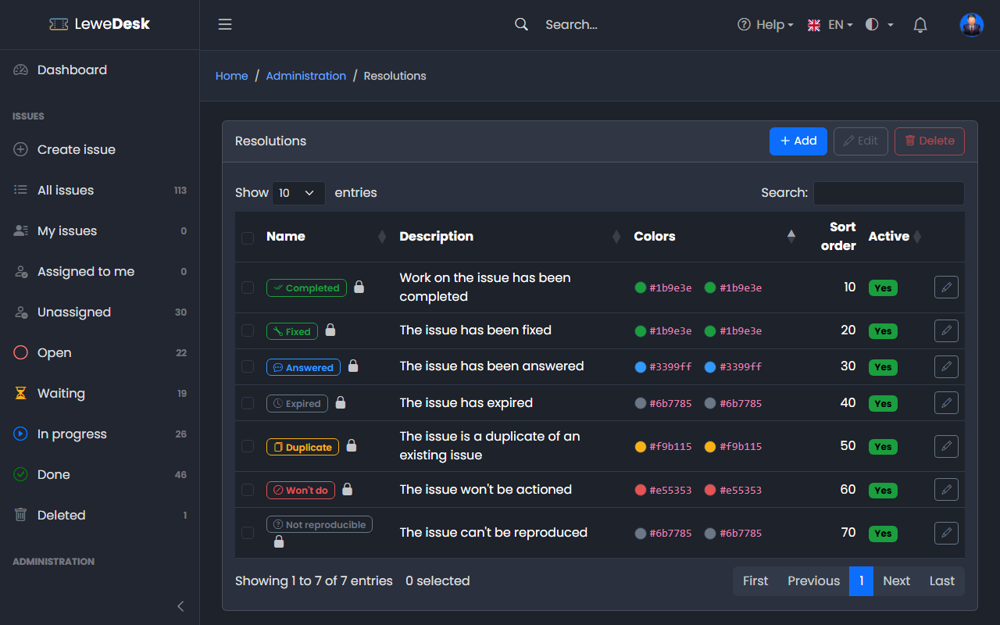
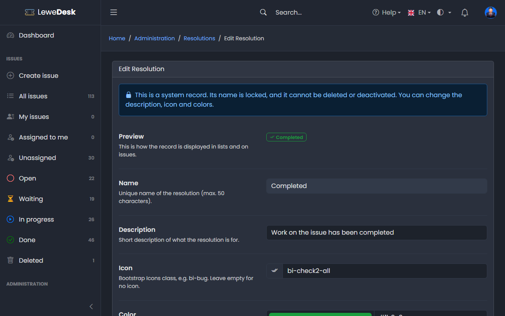

# Resolutions

<figure><figcaption></figcaption></figure>

A resolution says why an issue is done. It is empty until the issue is resolved and mandatory once the status is in the category _Done_ (the **Resolve** action and the Edit page ask for it). Requires the permission `manage_resolutions`.

## System resolutions

| Name             | Description                                     |
| ---------------- | ----------------------------------------------- |
| Completed        | Work on the issue has been completed            |
| Fixed            | The issue has been fixed                        |
| Answered         | The issue has been answered                     |
| Expired          | The issue has expired                           |
| Duplicate        | The issue is a duplicate of an existing issue   |
| Won't do         | The issue won't be actioned                     |
| Not reproducible | The issue can't be reproduced                   |


_Duplicate_ does not require a reference to another issue. Mention the original issue key (for example `LD-12`) in a comment. It is linked automatically.


## Buttons

| Button | Function                                                                                                    |
| ------ | ----------------------------------------------------------------------------------------------------------- |
| Add    | Opens the form to create a new resolution                                                                   |
| Edit   | Opens the Edit page for the selected resolution                                                             |
| Delete | Deletes the selected resolutions. System resolutions cannot be deleted. If issues use it, you select a replacement. |

## Add and Edit Resolution

<figure><figcaption></figcaption></figure>

See [common fields](README.md#common-fields).
