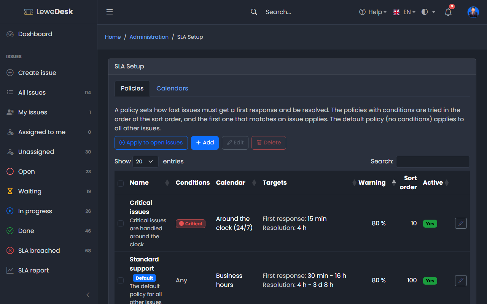
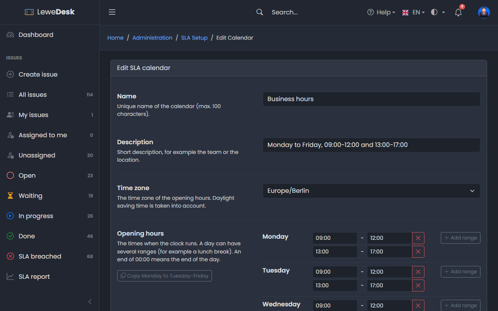
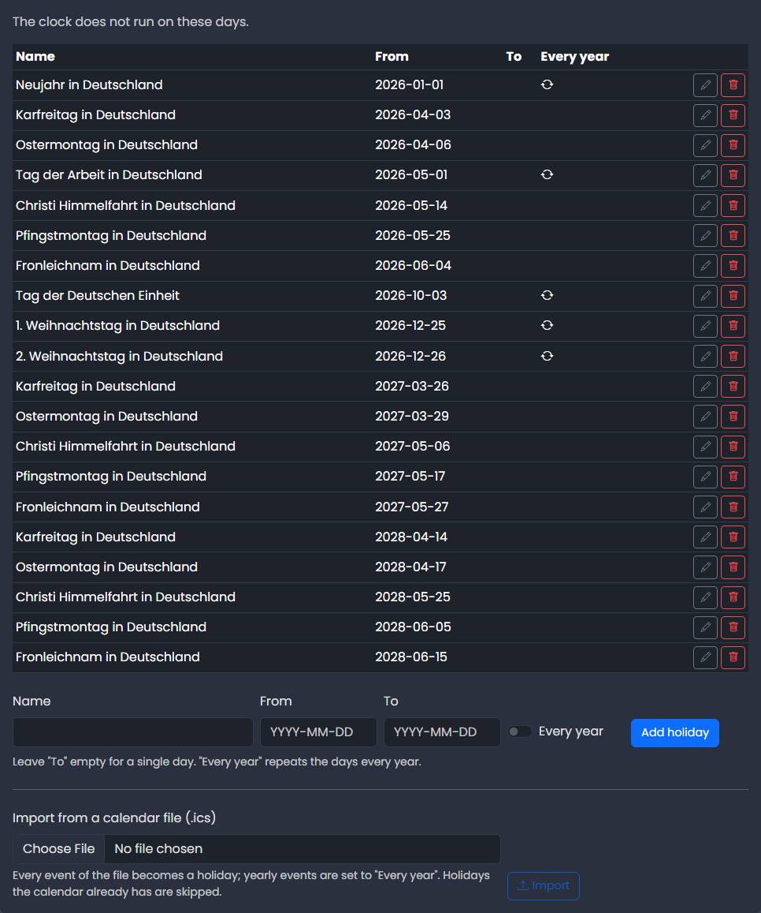

# SLA Calendars

<figure><figcaption></figcaption></figure>

A calendar tells when the clock of an [SLA policy](sla-policies.md) runs: the opening hours of each weekday in a time zone, and the holidays on which it does not run. Open **SLA Setup** in the sidebar and select the tab **Calendars**. Requires the permission `manage_sla`.

The list shows the name, a summary of the hours (for example _Mon-Fri 09:00-12:00, 13:00-17:00_), the time zone, the number of holidays and the number of policies that use the calendar.

## Buttons

| Button | Function |
| ------ | -------- |
| Add | Opens the form to create a new calendar |
| Edit | Opens the Edit page for the selected calendar |
| Delete | Deletes the selected calendar with its hours and holidays. A calendar that a policy uses cannot be deleted. |

## Add and Edit Calendar

<figure><figcaption></figcaption></figure>

| Field | Description |
| ----- | ----------- |
| Name | Unique name (max. 100 characters) |
| Description | For example the team or the location |
| Time zone | The time zone of the opening hours. Daylight saving time is taken into account. A new calendar starts with the time zone of your browser. |
| Opening hours | One row per weekday with any number of time ranges. A weekday without a range is _Closed_. |

A new calendar starts as Monday to Friday, 09:00 to 17:00.

* **Add range** adds a time range to a weekday. Use two ranges for a lunch break (for example 09:00-12:00 and 13:00-17:00). Ranges must not overlap.
* The **x** button removes a range.
* **Copy Monday to Tuesday-Friday** copies the ranges of Monday to the other weekdays.
* Enter times as `HH:MM` (24 hours). An end of `00:00` means the end of the day. The end of a range is exclusive: at the closing time the clock is already stopped.

Click **Save**. A new calendar opens on its edit page, where you can add holidays.


When you save changes to the hours, the time zone or the holidays of a calendar, the due times of the **running** timers that use it are recalculated. A breached timer can therefore change from time to time if you make the opening hours shorter.


## Holidays

<figure><figcaption></figcaption></figure>

The clock does not run on a holiday. Holidays belong to one calendar and are managed at the bottom of its edit page. They are saved immediately, there is no save button for the list. A calendar can have up to 500 holidays.

| Field | Description |
| ----- | ----------- |
| Name | Name of the holiday (max. 100 characters) |
| From | First day, as `YYYY-MM-DD` |
| To | Last day. Leave it empty for a holiday of one day. |
| Every year | Repeats the holiday every year on the same dates. A holiday of 29 February exists only in leap years. |

Use **Add holiday** to add one. To change a holiday, click the pencil in its row, change the values in the form and click **Save** (or **Cancel**). The trash can deletes it.

### Import holidays from a calendar file

Instead of typing every holiday you can import an iCalendar file (`.ics`), for example the public holidays of your country that many calendar services offer for download.

1. Open the edit page of the calendar.
2. Under **Import from a calendar file (.ics)** click **Choose file** and select the file (1 MB at most).
3. Click **Import**.

Every event of the file becomes a holiday:

| In the file | In LeweDesk |
| ----------- | ----------- |
| Title of the event | Name (cut after 100 characters) |
| Start | From |
| End | To. The end of an all-day event is the day _after_ its last day in the file, LeweDesk corrects this. |
| Event that repeats every year | _Every year_ is switched on |

Holidays the calendar already has (same name and dates, upper and lower case do not matter) are skipped, so you can import a file again without making duplicates. When the import is done, a message tells you how many holidays were **added**, **skipped** and how many **failed**. A holiday fails when the data is not valid or when the limit of 500 is reached.


Events that repeat in another way than every year (every month, every week) are imported once, on their first date.


## Several calendars

Create one calendar per team or location, for example _Support Berlin_ and _Support New York_, each with its own time zone and holidays, and select them in the policies. A policy without a calendar runs around the clock.
