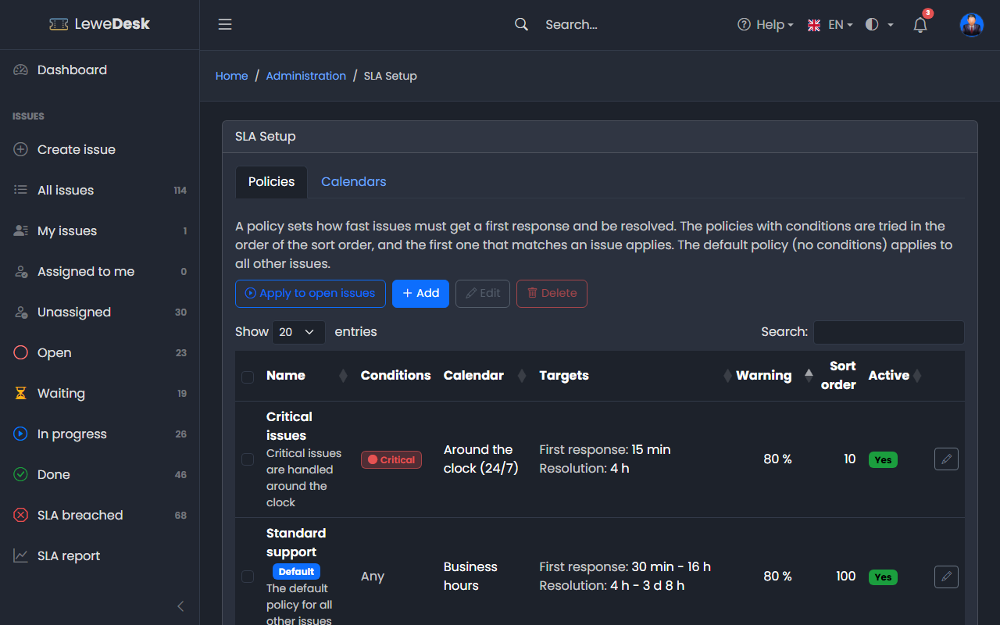
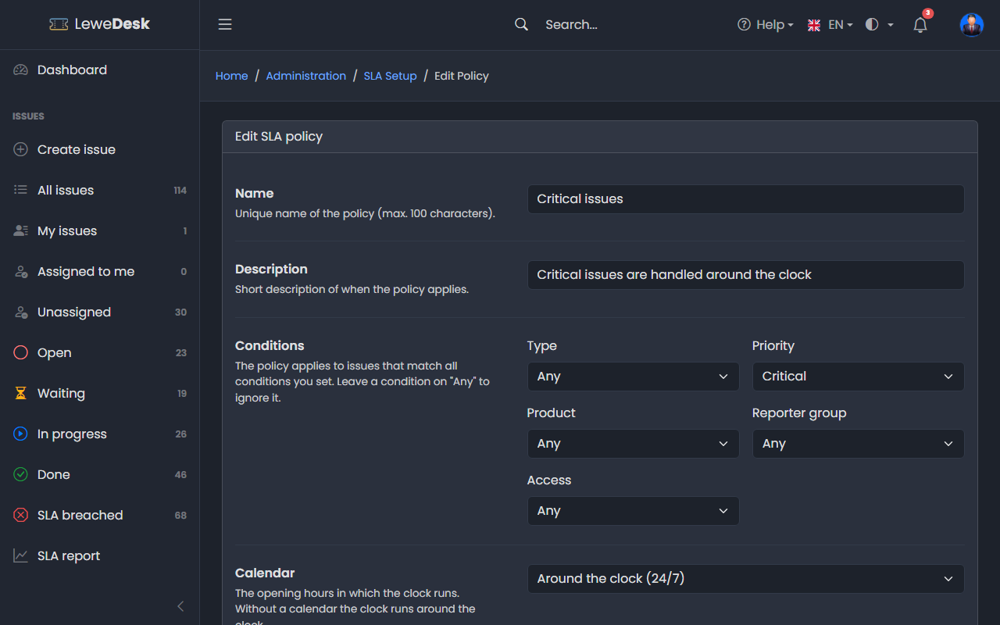

# SLA Policies

<figure><figcaption></figcaption></figure>

A service level agreement (SLA) says how fast an issue must get a first response and be resolved. An **SLA policy** holds the targets, the opening hours in which the clock runs, and the issues the policy applies to. Open **SLA Setup** in the sidebar (group _Issues_) and select the tab **Policies**. Requires the permission `manage_sla`. The pages are only available while the [license](../system/license.md) includes SLA.

## How SLA works

LeweDesk measures two things per issue:

| Metric | Clock starts | Clock stops |
| ------ | ------------ | ----------- |
| First response | When the issue is created | With the first **public** comment of an agent. Internal comments, comments of the reporter, comments of the agent who created the issue for a customer, and a change of assignee or status do not count. A reply by [email](../system/email-to-ticket.md) counts like a comment. |
| Resolution | When the issue is created | When the issue enters a status of the category _Done_. If the issue is reopened, a new resolution timer starts with the full target. The result of the earlier period is kept. |

Each running clock has a **due time**. A timer is in one of these states:

| State | Meaning |
| ----- | ------- |
| On track | Due time not reached, warning threshold not reached |
| At risk | The warning threshold (80% of the target by default) is reached |
| Breached | The due time has passed. The clock keeps running until the target is met, so the overrun can be reported. |
| Paused | The issue has a status that stops the clock |
| Met | The target was met, in time or late |
| Cancelled | The issue was deleted. Restoring the issue starts the clock again. |


Timers start for issues **created after** a policy is active, and for open issues when you click **Apply to open issues** (see below). Editing an old issue does not give it timers.


## Which policy applies

When an issue is created, LeweDesk picks one policy:

1. The active policies that have **conditions** are tried in the order of their **sort order** (lowest number first). The first one whose conditions all match applies.
2. If none matches, the **default policy** applies. This is the policy without any condition. There can be only one.
3. Within the policy, the target of the issue's priority applies. If the policy has no row for that priority, the row _All other priorities_ applies. Without either, that metric gets no timer.

When the type, priority, product or access of an issue changes, LeweDesk looks for the policy again. A timer that is still running moves to the new target. A timer that is **met** or **breached** is never changed, and a breach is never taken back. The reporter's group is only checked when the issue is created.

## Buttons

| Button | Function |
| ------ | -------- |
| Add | Opens the form to create a new policy |
| Edit | Opens the Edit page for the selected policy |
| Delete | Deletes the selected policy. A policy that has timers cannot be deleted. Deactivate it instead. |
| Apply to open issues | Starts the timers of all open issues that have none, with the policies as they are now |

The list shows the name (with a _Default_ badge), the conditions, the calendar, the shortest and longest target of each metric, the warning threshold, the sort order and whether the policy is active.

### Apply to open issues

Click **Apply to open issues** after you have created your first policies, or if you need timers on issues that exist already. The clock of such an issue starts when the issue was **created**, so an old issue can be breached at once. Issues that have timers are not changed. On a large installation the request can run out of time. Click the button again to continue.


Old breaches do not trigger a flood of messages: a target that was missed more than a day ago is only marked as handled, nobody is notified.


## Add and Edit Policy

<figure><figcaption></figcaption></figure>

| Field | Description |
| ----- | ----------- |
| Name | Unique name (max. 100 characters) |
| Description | When the policy applies |
| Conditions | Issue type, priority, product, reporter group and access. Each one defaults to _Any_. The policy applies to issues that match **all** conditions you set. While no condition is set, the form shows a notice that this is the default policy. |
| Calendar | The [calendar](sla-calendars.md) with the opening hours in which the clock runs. _Around the clock (24/7)_ if you select none. |
| Targets | One row per priority and a row _All other priorities_. For each metric enter a number and choose **Minutes**, **Hours** or **Days**. An empty field means no target. |
| Warning threshold | The share of the target after which the timer is **at risk** (default 80%) |
| Statuses that stop the clock | The clock does not run while the issue has one of these statuses. New policies start with _Waiting for customer_, _Pending_ and _On hold_. |
| Escalation | A user and/or a group who are told when a target is **breached**, besides the assignee and the watchers |
| Sort order | Policies with a lower number are tried first. Leave empty to put a new policy last. |
| Active | Only active policies apply to issues |

Targets are counted in **working time** of the calendar. A day is 24 hours of working time of the calendar, not a calendar day. A Critical issue with a target of 4 hours that arrives at 16:00 on a calendar that closes at 17:00 is due at 11:00 the next working day.

### Changing a policy later

* Changes to targets and conditions apply to **new** issues. Timers that run keep their stored target.
* A change of the **warning threshold** is applied to the running timers when you save.
* A policy that is in use cannot be deleted. The same is true for an issue type, status, priority, product or group that a policy uses. The message names the policies.
* Every change is written to the [Audit Log](../system/audit-log.md).

## Notifications and escalation

When a timer becomes **at risk** or **breached**, LeweDesk sends one in-app notification and one email per person and timer:

| Event | Who is told |
| ----- | ----------- |
| SLA at risk | The assignee and the watchers |
| SLA breached | The assignee, the watchers, and the escalation user and the members of the escalation group of the policy |

Only people who may see the issue **and** hold the permission `view_sla` are told. Reporters and customers never receive SLA messages. Every user can switch the two events on or off per channel in the [notification settings](../../user-guide/notifications.md). A breach also adds an internal entry to the [history](../../user-guide/issues/history.md) of the issue.


The check runs together with the regular housekeeping of LeweDesk, so a message can be up to **five minutes late**. If you use targets of a few minutes, run `api/housekeeping.php` from a scheduled task every minute.


## Permissions and license

| Permission | Allows |
| ---------- | ------ |
| `view_sla` | See SLA data on issues, filter and sort the list by SLA, and open the [SLA report](../../user-guide/sla-report.md). Agents and Administrators have it by default. |
| `manage_sla` | Manage policies, calendars and holidays, apply policies to open issues, and [change the due time](../../user-guide/issues/sla.md#change-the-due-time) of an issue. Administrators have it by default. |

In the limited mode of an invalid [license](../system/license.md) the SLA pages and the report are closed and no new timers start. Your configuration and the timers are kept, and everything works again when the license is valid.
