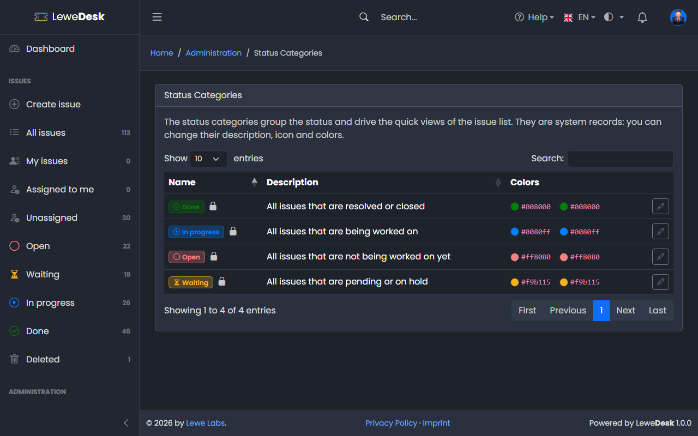
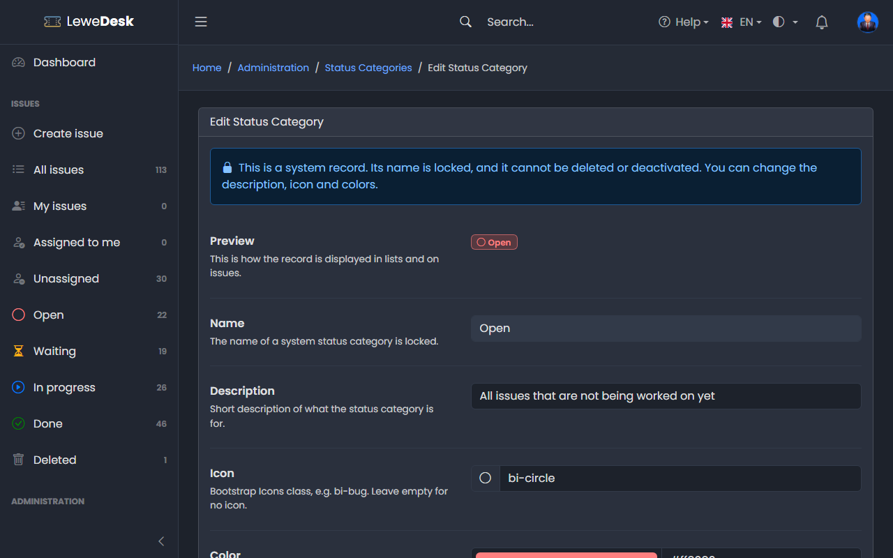

# Status Categories

<figure><figcaption></figcaption></figure>

Status categories group the [status](status.md). They drive the quick views in the sidebar (_Open_, _Waiting_, _In progress_, _Done_), the dashboard charts and the rule that an issue needs a resolution once it reaches the category _Done_. Requires the permission `manage_status_categories`.

## System status categories

| Name        | Description                                      |
| ----------- | ------------------------------------------------ |
| Open        | All issues that are not being worked on yet      |
| Waiting     | All issues that are pending or on hold           |
| In progress | All issues that are being worked on              |
| Done        | All issues that are resolved or closed           |

The status categories are system records. You cannot add or delete them and their name is locked. You can change description, icon and colors.

## Edit Status Category

<figure><figcaption></figcaption></figure>

| Field            | Description                    |
| ---------------- | ------------------------------ |
| Description      | What the category is for       |
| Icon             | Bootstrap Icons class          |
| Color            | Color of the icon and the text |
| Background color | Background color               |
