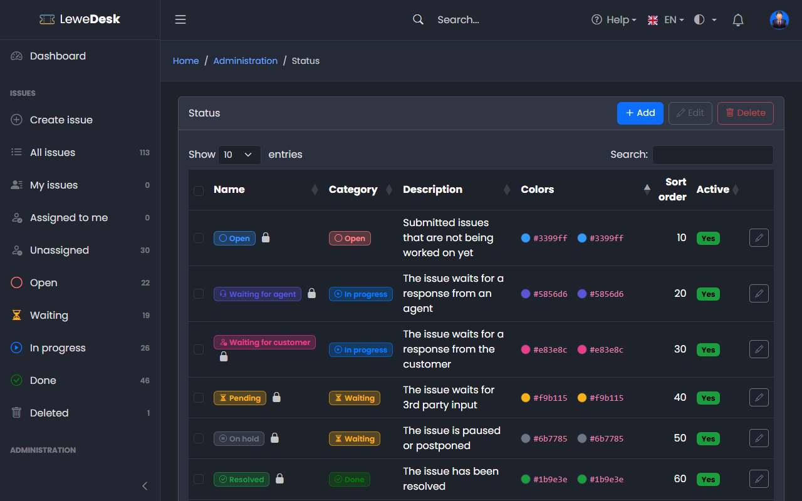
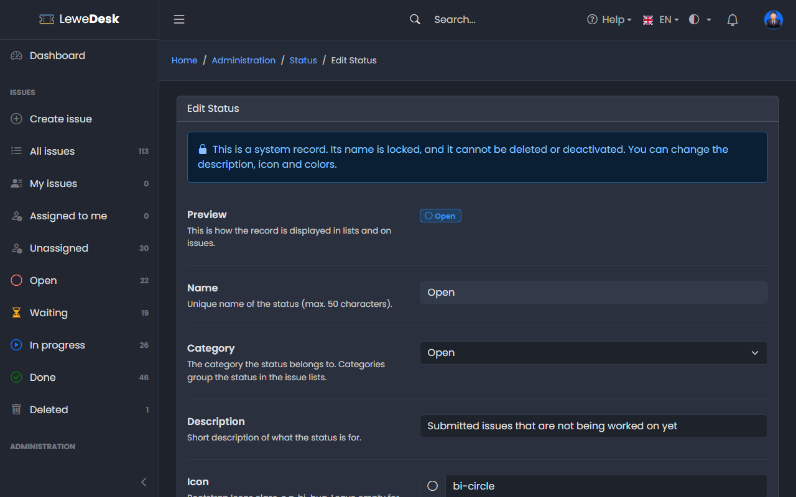

# Status

<figure><figcaption></figcaption></figure>

The status tells where an issue is in its life. Each status belongs to a [status category](status-categories.md). Requires the permission `manage_status`.

The list rows of the issue list get the background color of the issue's status (users can turn this off in their [profile](../../user-guide/profile.md)).

## System status

| Name                 | Category    | Description                                      |
| -------------------- | ----------- | ------------------------------------------------ |
| Open                 | Open        | Submitted issues that are not being worked on yet |
| Waiting for agent    | In progress | The issue waits for a response from an agent     |
| Waiting for customer | In progress | The issue waits for a response from the customer |
| Pending              | Waiting     | The issue waits for 3rd party input              |
| On hold              | Waiting     | The issue is paused or postponed                 |
| Resolved             | Done        | The issue has been resolved                      |
| Closed               | Done        | The resolution of the issue has been accepted    |

The [issue actions](../../user-guide/issues/issue-actions.md) set _Open_, _Waiting for agent_, _Waiting for customer_, _Resolved_ and _Closed_ (for example, _Respond_ switches between _Waiting for agent_ and _Waiting for customer_). _Pending_ and _On hold_ are set by agents on the [Edit Issue](../../user-guide/issues/edit-issue.md) page. You can add more status. There is no fixed workflow: an agent can set any status.

## Buttons

| Button | Function                                                                                                                  |
| ------ | ------------------------------------------------------------------------------------------------------------------------- |
| Add    | Opens the form to create a new status                                                                                     |
| Edit   | Opens the Edit page for the selected status                                                                               |
| Delete | Deletes the selected status. System status cannot be deleted. If issues use it, you select a replacement.                 |

## Add and Edit Status

<figure><figcaption></figcaption></figure>

In addition to the [common fields](README.md#common-fields) you select the **Category** of the status.


A status of the category _Done_ needs a resolution on the issue.

