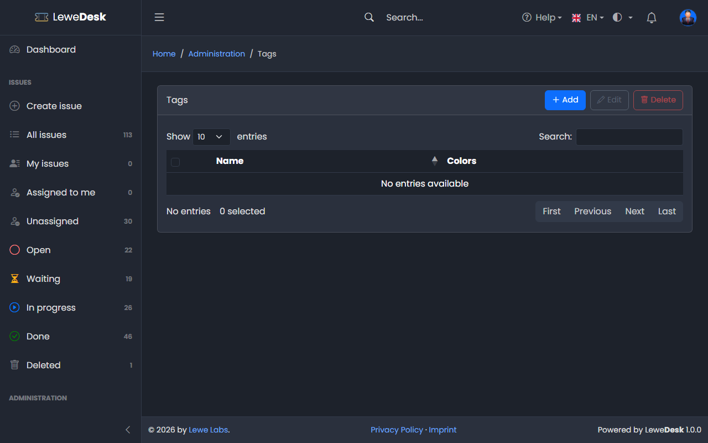
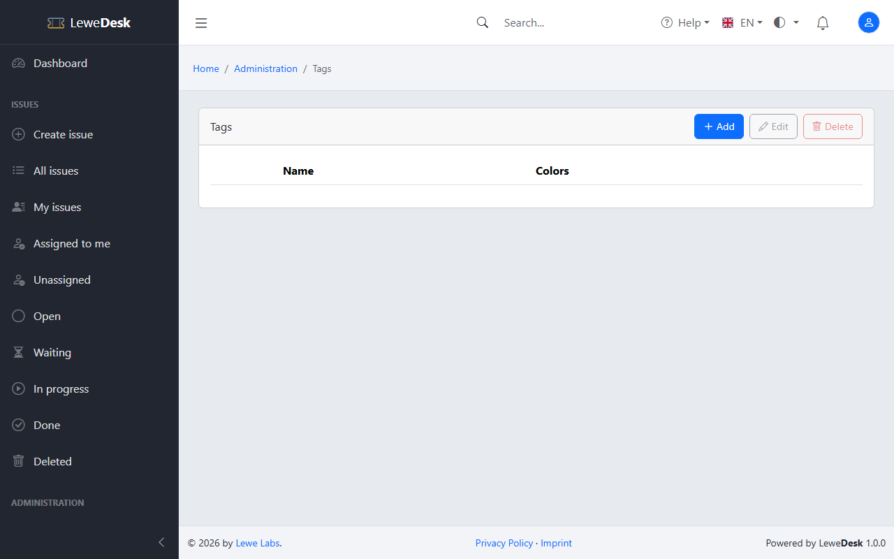

# Tags

<figure><figcaption></figcaption></figure>

Tags are free labels that help to find and group issues. Anybody who can create an issue can add tags there: while typing, existing tags are suggested, and a tag that does not exist yet is created after a confirmation. This page is for tidying up: it requires the permission `manage_tags` to edit or delete tags. The list is empty until the first tag is used.

## Buttons

| Button | Function                                                                    |
| ------ | --------------------------------------------------------------------------- |
| Add    | Opens the form to create a new tag                                          |
| Edit   | Opens the Edit page for the selected tag                                    |
| Delete | Deletes the selected tags. The tag is removed from the issues that use it.  |

## Add and Edit Tag

<figure><figcaption></figcaption></figure>

| Field            | Description                    |
| ---------------- | ------------------------------ |
| Name             | Unique name of the tag         |
| Text color       | Color of the tag text          |
| Background color | Background color of the tag    |
