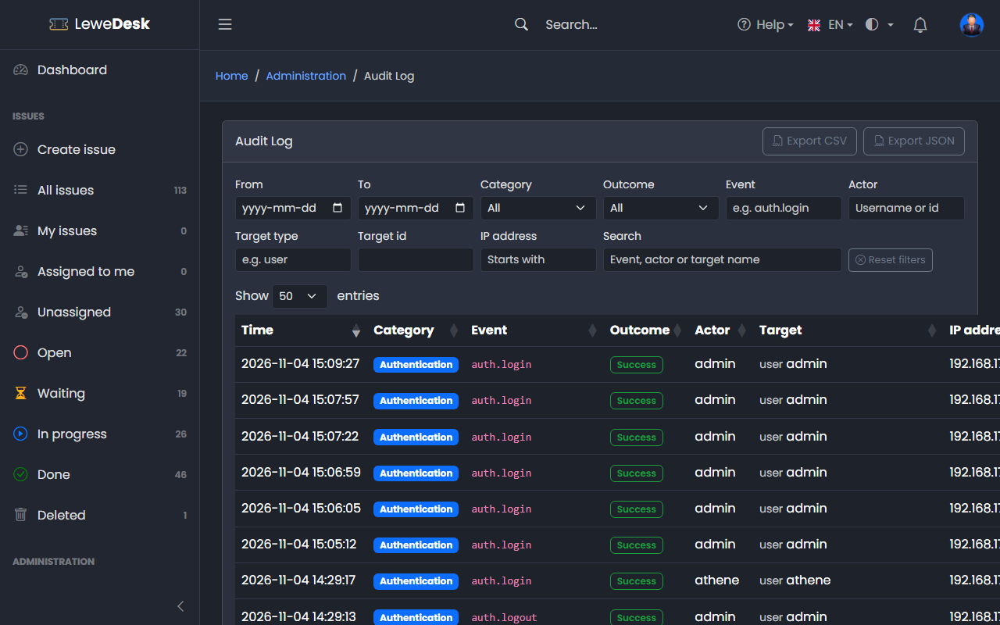
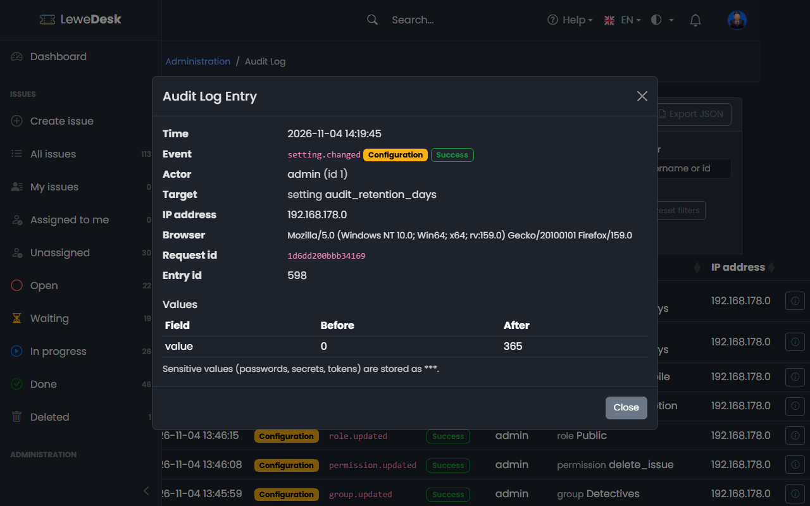

# Audit Log

<figure><figcaption></figcaption></figure>

The audit log records who did what, when and from where: logins, changes to accounts and configuration, and security-relevant events. Use it to trace a change back to the person who made it, or to investigate failed logins and denied access.

Open it with **Administration > System > Audit Log**. The page is available to administrators only and, like the log itself, is in English. In the [limited mode of the license](license.md) the page cannot be opened; entries are still written.


The audit log is for the administration of the system. The day-to-day activity of an issue (creating, commenting, changing the status) is not part of it: it stays in the [History](../../user-guide/issues/history.md) of the issue.


## The list

The newest entries come first. Click a column header to sort, and use the paging at the bottom (25, 50, 100 or 200 entries per page).

| Column     | Description                                                                                       |
| ---------- | ------------------------------------------------------------------------------------------------- |
| Time       | When it happened, in the time zone of the [system settings](settings.md) (not that of your browser) |
| Category   | Authentication, Users, Configuration, Data, Security or Audit log                                 |
| Event      | What happened, e.g. `auth.login` or `role.updated` (see the table below)                           |
| Outcome    | **Success**, or **Failure** for an attempt that did not happen (wrong password, denied access)    |
| Actor      | The user who did it. Empty for anonymous requests and the system.                                 |
| Target     | What it was done to: the type (e.g. user, setting, role) and its name                             |
| IP address | The address the request came from, shortened (see below)                                          |

### Filters

The filters above the list apply at once; text fields apply a moment after you stop typing. **Reset filters** clears them all.

| Filter      | Description                                                                 |
| ----------- | --------------------------------------------------------------------------- |
| From, To    | Days (both inclusive), in the time zone of the system settings              |
| Category    | One of the categories                                                       |
| Outcome     | Success or failure                                                          |
| Event       | The exact event, e.g. `user.deleted` (the field suggests the known events)  |
| Actor       | The user name (or part of it) or the user id                                |
| Target type | e.g. `user`, `role`, `setting`                                              |
| Target id   | The id of the target                                                        |
| IP address  | The start of an address, e.g. `192.168.`                                    |
| Search      | Part of the event, the actor name or the target name                        |

## Details

<figure><figcaption></figcaption></figure>

Click a line to open its details: all fields of the entry and, for changes, a table with the value of every changed field **before** and **after**. Passwords, secrets and tokens are never stored; where such a value was part of a change, both columns show `***`.

## Export

**Export CSV** and **Export JSON** save everything that matches the current filters and sort order. There is no limit on the number of entries. The CSV file is UTF-8 and opens correctly in common spreadsheet programs; texts that a spreadsheet could mistake for a formula get a leading apostrophe.

Every export is itself recorded in the log (`audit.exported`, with the format, the filters and the number of entries).

## What is logged

| Category       | Events                                                                                                                                                                             |
| -------------- | ---------------------------------------------------------------------------------------------------------------------------------------------------------------------------------- |
| Authentication | Login, logout, failed login (existing account, wrong password), password change, password reset requested and completed, 2FA enabled, disabled, reset by an administrator, wrong 2FA code, 2FA lock, 2FA bypass (`DISABLE_ADMIN_2FA`), login refused because the license expired (only with `LICENSE_LOCK=1`) |
| Users          | Account registered, account changed (email, names), roles changed, groups changed, account deleted                                                                                  |
| Configuration  | Every changed system setting (one entry per setting); license key saved, license activated, domain deregistered, change of the license state, license server unreachable (see [License](license.md)); roles, groups, permissions, issue types, status, status categories, resolutions, products and tags created, changed and deleted |
| Data           | Issue deleted, issue restored, attachment deleted, custom view created, changed and deleted (also when its private views are removed with a deleted user) |
| Security       | A request that was denied for lack of permission (403), an invalid or expired 2FA login token                                                                                       |
| Audit log      | An export of the log                                                                                                                                                                |

An entry for a change holds only the fields that changed. A change and its entry are saved together: if the entry cannot be written, the change is not made either.

### What is not logged

* Viewing data (lists, issues, the audit log itself) &ndash; only changes and exports
* Failed logins with a user name that does not exist
* Passwords, secrets, tokens and the text of comments
* Regular issue activity: creating, commenting, status changes, assignments (see the History of the issue)

## IP addresses

To protect privacy the log stores the address in shortened form: the last block of an IPv4 address is replaced by `0` (`203.0.113.77` becomes `203.0.113.0`) and an IPv6 address is cut to its first 48 bits. The browser identification (user agent) is stored as sent. The privacy policy of the installation mentions this.

## Retention

Entries older than the **Audit Log Retention (Days)** setting are deleted automatically (default **365**, maximum 3650). `0` keeps them forever. See [Settings](settings.md).

## Access and integrity

* The page and the API need the permission `view_audit_log`, which only the **Administrator** role holds. Granting the permission to another role does not open the log: the Administrator role is required in addition.
* Entries cannot be edited or deleted, neither in the application nor through the API. They only disappear through the retention above.

## Existing data and test data

When the audit log was introduced, entries were created from what already existed (accounts, roles, groups, permissions, products, tags and so on, dated with their creation date, without an actor). They carry the note `backfilled` in their values. On a development system the script `db_sample_audit.sql` adds sample entries marked `sample`; do not run it on a production system.
