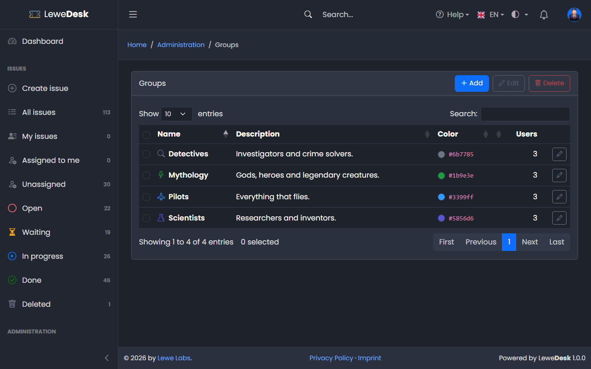
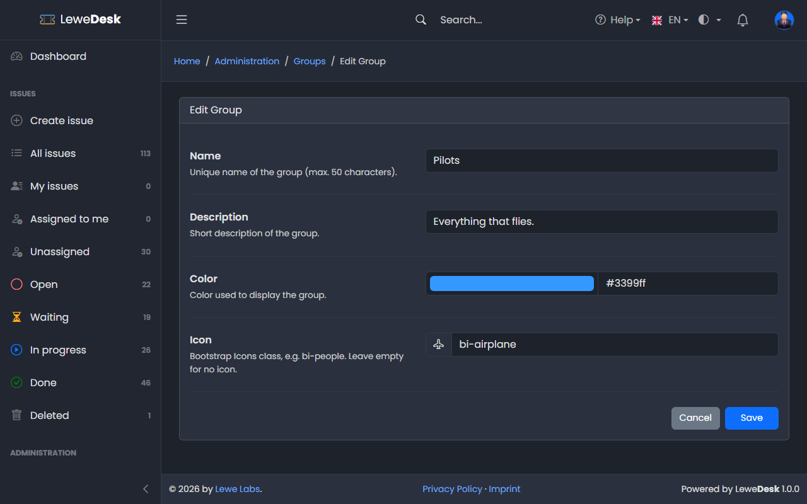

# Groups

<figure><figcaption></figcaption></figure>

Groups collect users, for example a department or a customer. A permission can be granted to a group, so that all its members hold it (see [Permissions](permissions.md)). Users are added to groups on the [Edit User](users.md) page.

## Buttons

| Button | Function                                         |
| ------ | ------------------------------------------------ |
| Add    | Opens the form to create a new group             |
| Edit   | Opens the Edit page for the selected group       |
| Delete | Deletes the selected groups after a confirmation |

## Add and Edit Group

<figure><figcaption></figcaption></figure>

| Field       | Description                                                       |
| ----------- | ----------------------------------------------------------------- |
| Name        | Unique name of the group (max. 50 characters)                     |
| Description | Short description of the group                                    |
| Color       | Color used to display the group                                   |
| Icon        | Bootstrap Icons class, e.g. `bi-people`. Leave empty for no icon. |
