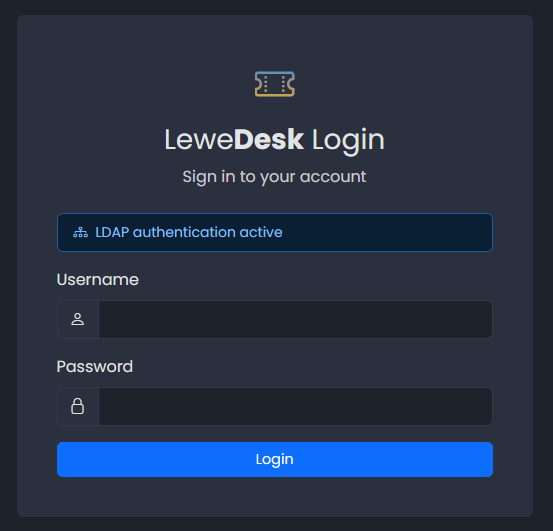

# LDAP Authentication

LeweDesk can check the passwords of its users against an LDAP server (for example OpenLDAP or Microsoft Active Directory) instead of its own database. LDAP is only used to **authenticate**: LeweDesk never creates accounts from LDAP and never copies data (email, name, ...) from it.

## How it works

When LDAP is switched on:

* The user **admin** always logs in with the password in the LeweDesk database, so you can always get in, even when the LDAP server is down.
* All other users log in with their LDAP password. The password stored in the LeweDesk database is not used, but it stays as it is. If you switch LDAP off again, the users can use it again.
* A user must already have a LeweDesk account with the same username. If somebody logs in with a correct LDAP password but has no account, the login fails with _Unknown LeweDesk user._ An administrator creates the account on the [Users](users.md) page (**Add**). No password is set there.
* Two factor authentication still applies (see [Two Factor Authentication](../../user-guide/two-factor-authentication.md)).
* The password of an LDAP user cannot be changed in LeweDesk: the password fields in the profile and on the user page are replaced with a note, and the password reset and the registration are switched off. Change the password where your LDAP is managed.
* The login page shows _LDAP authentication active_, administrators see an **LDAP** badge in the top bar, and the user list marks every LDAP user with an **LDAP** badge.

<figure><figcaption>Login page with LDAP authentication active</figcaption></figure>

The login is checked in these steps: LeweDesk connects to the server, optionally binds with a read-only account (the _search bind_), searches the user below the search base (`uid=<username>`, or `sAMAccountName=<username>` for Active Directory), and finally tries to bind as that user with the password entered. Only the result of this last step counts.

## Configuration

LDAP is configured in the `.env` file in the folder of the application, not on a settings page. This way the settings survive an upgrade of LeweDesk.

| Key | Description | Default |
| --- | ----------- | ------- |
| `LDAP_YES` | `1` switches LDAP authentication on, `0` off | `0` |
| `LDAP_ADS` | `1` for Microsoft Active Directory (the user is found by `sAMAccountName`), `0` for other servers (found by `uid`) | `0` |
| `LDAP_HOST` | Host name or IP address of the LDAP server | none |
| `LDAP_PORT` | Port of the LDAP server | `389` (`636` if `LDAP_TLS=2`) |
| `LDAP_DIT` | Distinguished name of the read-only account for the search bind, e.g. `cn=read-only-admin,dc=example,dc=com` | none |
| `LDAP_PASS` | Password of that account | none |
| `LDAP_SBASE` | Search base below which the users are searched, e.g. `dc=example,dc=com` | none |
| `LDAP_TLS` | `0` no encryption, `1` STARTTLS on the LDAP port (usually 389), `2` LDAPS, implicit TLS (usually port 636) | `0` |
| `LDAP_CHECK_ANONYMOUS_BIND` | `1` tries an anonymous bind first and stops with a configuration error if the server refuses it | `0` |
| `LDAP_SEARCH_BIND` | `1` binds with `LDAP_DIT` and `LDAP_PASS` before searching for the user. Needed if the server does not allow anonymous searches (Active Directory usually does not). | `0` |
| `LDAP_USER_ATTR` | The attribute that holds the username | `uid`, or `sAMAccountName` if `LDAP_ADS=1` |
| `LDAP_TIMEOUT` | Seconds to wait for the server | `5` |

Write each setting on its own line and do not put a comment behind a value. A comment on a line of its own (starting with `#`) is fine.

Example for the free online LDAP test server of forumsys.com (see below):

```
LDAP_YES=1
LDAP_ADS=0
LDAP_HOST=ldap.forumsys.com
LDAP_PORT=389
LDAP_DIT=cn=read-only-admin,dc=example,dc=com
LDAP_PASS=password
LDAP_SBASE=dc=example,dc=com
LDAP_TLS=0
LDAP_CHECK_ANONYMOUS_BIND=0
LDAP_SEARCH_BIND=1
```


Without `LDAP_TLS=1` or `2` the passwords of your users travel over the network in plain text. Use encryption for every real installation. Plain LDAP is only meant for tests.



The PHP extension **ldap** must be loaded on the web server. Without it, every login except admin fails with _LDAP configuration error on LeweDesk server._


## Messages at login

| Message | Meaning |
| ------- | ------- |
| Invalid credentials | Wrong username or password, or the password is empty |
| Unknown LeweDesk user. | The LDAP login is correct, but there is no LeweDesk account with this username. Create it on the [Users](users.md) page. |
| Authentication server unavailable | The LDAP server cannot be reached (host, port, firewall, timeout). The details are in the error log of the server. |
| LDAP configuration error on LeweDesk server. | The settings are incomplete or wrong, the search base or the search bind account is rejected, STARTTLS failed, or the PHP extension is missing. The details are in the error log of the server. |

The logins and failed logins are recorded in the [Audit Log](audit-log.md) (`auth.login`, `auth.login_failed`) with the method `ldap` (or `local` for admin and for logins while LDAP is off).

## Switching LDAP on

1. Make sure every person who should log in has a LeweDesk account with the **same username** as in LDAP (**Add** on the [Users](users.md) page, or the existing account).
2. Enter the settings in `.env` and set `LDAP_YES=1`. Keep the `.env` file in a safe place, it holds the password of the search account.
3. Log in as a normal user in a second browser window to test it **before** you log out as admin.

If something is wrong, log in as **admin** (always possible) and fix the settings, or set `LDAP_YES=0`.

## Testing with the forumsys LDAP test server

The company forumsys offers a public LDAP server for tests, see [Online LDAP Test Server](https://www.forumsys.com/2022/05/10/online-ldap-test-server/). It has users such as `galileo`, `einstein` and `tesla`, all with the password `password`. Use the example above, create a LeweDesk account `galileo` and log in with `galileo` and `password`. Do not use this server for anything real: everybody on the internet can read it.
