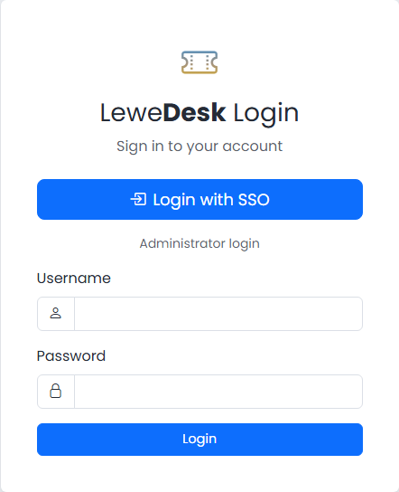

# OIDC Authentication

LeweDesk supports single sign-on (SSO) with **OpenID Connect (OIDC)**. Users sign in at your identity provider (for example Keycloak, Microsoft Entra ID or Authentik) and come back to LeweDesk already logged in. OIDC is only used to **authenticate**: LeweDesk never creates accounts from OIDC and never copies data (email, name, ...) from it.

## How it works

When OIDC is switched on:

* The login page shows a **Login with SSO** button. The username and password form stays, labeled _Administrator login_.
* The user **admin** always logs in with the password in the LeweDesk database, so you can always get in, even when the identity provider is down. An SSO login that resolves to admin is refused.
* The local login form is closed for all other users.
* A user must already have a LeweDesk account whose username equals the `preferred_username` of the identity provider (not case-sensitive). If there is none, the login fails with _Unknown LeweDesk user._ An administrator creates the account on the [Users](users.md) page (**Add**). No password is set there. LeweDesk never matches by email.
* At the first SSO login LeweDesk binds the unique subject (`sub`) of the identity provider to the account. From then on the account is found by the subject. This is recorded in the [Audit Log](audit-log.md) as `auth.oidc_bound`.
* Two factor authentication of LeweDesk does not apply to SSO users: it is managed by the identity provider. The user **admin** keeps it. See [Two Factor Authentication](../../user-guide/two-factor-authentication.md).
* The password of an SSO user cannot be changed in LeweDesk: the password fields in the profile and on the user page are replaced with a note, and the password reset and the registration are switched off. The user list marks every SSO user with an **SSO** badge, and administrators see an **SSO** badge in the top bar.
* OIDC wins over [LDAP](ldap-authentication.md): with `OIDC_YES=1` LDAP is not used.
* The logout only ends the LeweDesk session. The session at the identity provider stays, so the SSO button may sign you in again without asking for a password. The LeweDesk session lasts as long as set by the session expiration in the [Settings](settings.md).

<figure><figcaption>Login page with OIDC authentication active</figcaption></figure>

LeweDesk uses the authorization code flow with PKCE and requests the scopes `openid profile`. The ID token is verified (RS256 signature against the keys of the provider, issuer, audience, expiry and nonce).

## Configuration

OIDC is configured in the `.env` file in the folder of the application, not on a settings page. This way the settings survive an upgrade of LeweDesk. They are also not part of the database export and import.

| Key | Description | Default |
| --- | ----------- | ------- |
| `OIDC_YES` | `1` switches OIDC authentication on, `0` off | `0` |
| `OIDC_PROVIDER_URL` | Issuer URL of the provider. `/.well-known/openid-configuration` must be found below it, and its `issuer` must be identical. | none |
| `OIDC_CLIENT_ID` | Client ID registered at the provider | none |
| `OIDC_CLIENT_SECRET` | Client secret of this (confidential) client | none |
| `OIDC_REDIRECT_URI` | `https://your-lewedesk-server.com/api/auth/oidc/callback`. It must be registered at the provider exactly like this. | none |
| `OIDC_TIMEOUT` | Seconds to wait for the provider | `5` |
| `OIDC_VERIFY_TLS` | `1` verifies the TLS certificate of the provider, `0` does not (tests only) | `1` |

Write each setting on its own line and do not put a comment behind a value. A comment on a line of its own (starting with `#`) is fine.

Example for Keycloak:

```
OIDC_YES=1
OIDC_PROVIDER_URL=https://keycloak.example.com/realms/mycompany
OIDC_CLIENT_ID=lewedesk
OIDC_CLIENT_SECRET=your-client-secret-here
OIDC_REDIRECT_URI=https://your-lewedesk-server.com/api/auth/oidc/callback
```


The PHP extensions **curl** and **openssl** must be loaded on the web server. Without them SSO logins fail with a configuration error.


### Keycloak client

In the Keycloak admin console create a client in your realm:

1. **Client ID**: `lewedesk` (or your choice, then use it in `OIDC_CLIENT_ID`).
2. **Client authentication**: on (confidential client), with the **Standard flow** enabled.
3. **Valid redirect URIs**: the value of `OIDC_REDIRECT_URI`.
4. Copy the secret from the **Credentials** tab to `OIDC_CLIENT_SECRET`.
5. The users in Keycloak need the same username as in LeweDesk.

Other providers need the same: a confidential web client, the redirect URI, and the claim `preferred_username` in the ID token.

## Messages at login

If the SSO login fails, you are taken back to the login page with a message:

| Message | Meaning |
| ------- | ------- |
| Unknown LeweDesk user. | The login at the provider worked, but there is no LeweDesk account with this username. Create it on the [Users](users.md) page. |
| The administrator account cannot sign in with SSO. Use the administrator login below. | The SSO login belongs to **admin**. Use the _Administrator login_ form. |
| The application is under maintenance. Only administrators can log in. | Maintenance mode is on and the user is not an administrator. |
| The SSO login has expired. Please try again. | The login took more than 10 minutes, or the page was opened twice. |
| The SSO server is not available. Please try again later. | Host, port, firewall, TLS or timeout. The details are in the error log of the server. |
| The SSO login could not be verified. Please try again or contact your administrator. | The ID token or the answer was rejected (signature, issuer, audience, nonce). |
| The SSO login was cancelled or refused. | The user cancelled at the provider, or the provider returned an error. |
| SSO configuration error on LeweDesk server. | Settings missing or wrong, or a PHP extension is missing. |
| SSO is not active. | `OIDC_YES` is not `1`. |

The logins and failed logins are recorded in the [Audit Log](audit-log.md) (`auth.login`, `auth.login_failed`) with the method `oidc`.

## Switching OIDC on

1. Register the client at the identity provider (see above) and make sure every person who should log in has a LeweDesk account with the **same username** as the `preferred_username` there.
2. Enter the settings in `.env` and set `OIDC_YES=1`. Keep the `.env` file in a safe place, it holds the client secret.
3. Test it in a second browser window **before** you log out as admin.

If something is wrong, log in as **admin** with the _Administrator login_ form and fix the settings, or set `OIDC_YES=0`.
