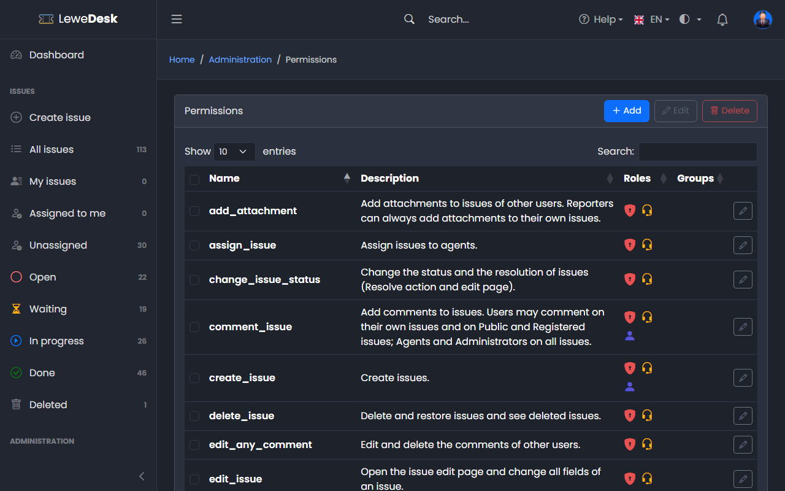
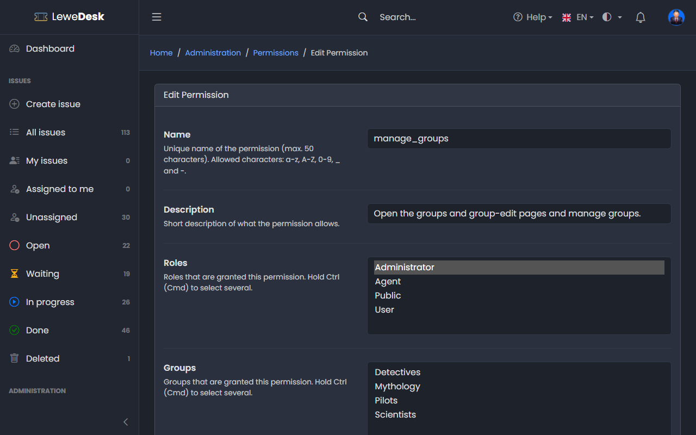

# Permissions

<figure><figcaption></figcaption></figure>

A permission allows one specific thing. Each permission is granted to roles and/or groups. Administrators bypass all permission checks.

## Buttons

| Button | Function                                               |
| ------ | ------------------------------------------------------ |
| Add    | Opens the form to create a new permission              |
| Edit   | Opens the Edit page for the selected permission        |
| Delete | Deletes the selected permissions after a confirmation  |

## Edit Permission

<figure><figcaption></figcaption></figure>

| Field       | Description                                                                                   |
| ----------- | --------------------------------------------------------------------------------------------- |
| Name        | Unique name (max. 50 characters). Allowed characters: a-z, A-Z, 0-9, \_ and -                 |
| Description | Short description of what the permission allows                                               |
| Roles       | Roles that are granted this permission. Hold Ctrl (Cmd) to select several.                    |
| Groups      | Groups that are granted this permission. Hold Ctrl (Cmd) to select several.                   |

## Default permissions

### Issues

| Permission               | Default roles                    | Allows                                                                                     |
| ------------------------ | -------------------------------- | ------------------------------------------------------------------------------------------ |
| `view_issue`             | Public, User, Agent, Administrator | See issues, comments and attachments within the scope of the issue access (see below)    |
| `view_all_issues`        | Agent, Administrator             | See all issues regardless of their access, including _Reporter only_ issues of other users |
| `create_issue`           | User, Agent, Administrator       | Create issues                                                                              |
| `comment_issue`          | User, Agent, Administrator       | Comment. Users: own, _Public_ and _Registered_ issues. Agents: all issues.                |
| `view_internal_comments` | Agent, Administrator             | See internal comments and their attachments                                                |
| `edit_any_comment`       | Agent, Administrator             | Edit and delete comments of other users                                                    |
| `edit_issue`             | Agent, Administrator             | Open the Edit page and change all fields                                                   |
| `assign_issue`           | Agent, Administrator             | Assign issues to Agents                                                                    |
| `change_issue_status`    | Agent, Administrator             | Change status and resolution (Resolve action and Edit page)                                |
| `delete_issue`           | Agent, Administrator             | Delete and restore issues, see the _Deleted_ view                                          |
| `add_attachment`         | Agent, Administrator             | Add attachments to issues of other users. Reporters can always add to their own issues.   |

### Administration

| Permission                 | Default roles | Allows                                       |
| -------------------------- | ------------- | -------------------------------------------- |
| `manage_users`             | Administrator | Manage users                                 |
| `manage_roles`             | Administrator | Manage roles                                 |
| `manage_groups`            | Administrator | Manage groups                                |
| `manage_permissions`       | Administrator | Manage permissions                           |
| `manage_settings`          | Administrator | Change the system settings                   |
| `view_audit_log`           | Administrator | Open and export the [Audit Log](audit-log.md). The Administrator role is required as well. |
| `manage_issue_types`       | Administrator | Manage issue types                           |
| `manage_status`            | Administrator | Manage status                                |
| `manage_status_categories` | Administrator | Edit the status categories                   |
| `manage_resolutions`       | Administrator | Manage resolutions                           |
| `manage_priorities`        | Administrator | Manage priorities                            |
| `manage_products`          | Administrator | Manage products                              |
| `manage_tags`              | Administrator | Edit and delete tags                         |
| `manage_custom_views`      | Administrator | Open the [Custom Views](../issues/custom-views.md) page and edit or delete the custom views of all users. Users manage their own views without a permission. |

## Who can see an issue?

Every issue has an _Access_ value. Together with `view_issue` and `view_all_issues` it decides who sees the issue:

| Access        | Visitor (not logged in) | Logged in user | Reporter | Agent / Administrator |
| ------------- | ----------------------- | -------------- | -------- | --------------------- |
| Public        | sees                    | sees           | sees     | sees                  |
| Registered    | no                      | sees           | sees     | sees                  |
| Reporter only | no                      | no             | sees     | sees                  |

If you want to keep all issues private, take `view_issue` away from the role _Public_.


Rate limits for issues and comments do not apply to Agents and Administrators. See [Settings](settings.md).

