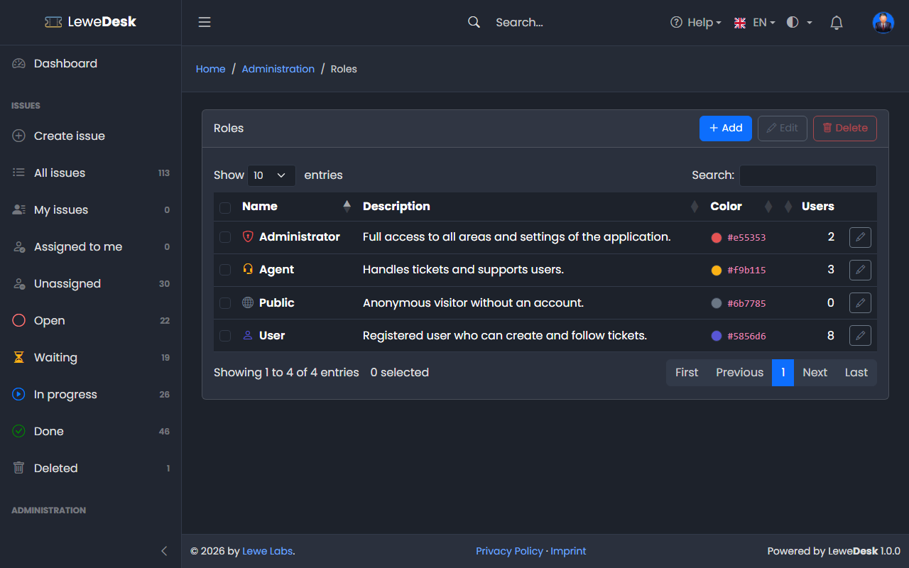
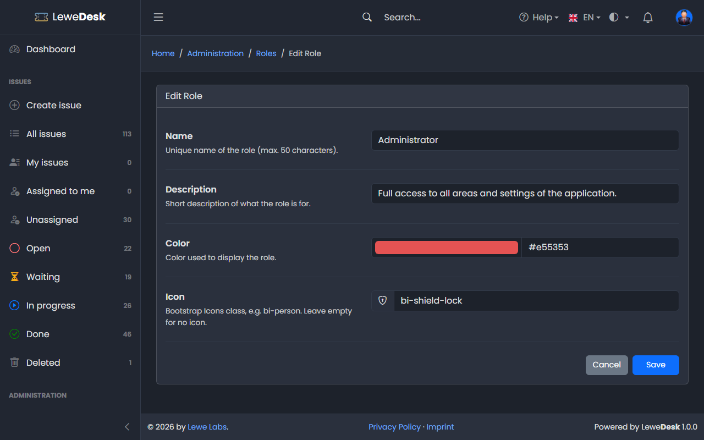

# Roles

<figure><figcaption></figcaption></figure>

Roles bundle permissions. Users get one or more roles (see [Users](users.md)).

## Default roles

| Role          | Purpose                                                                   |
| ------------- | ------------------------------------------------------------------------- |
| Administrator | Full access to all areas and settings of the application                  |
| Agent         | Handles issues and supports users. Only Agents can be assigned to issues. |
| User          | Registered user who can create and follow issues                          |
| Public        | Anonymous visitor without an account                                      |


The default roles are system entries: they can be neither deleted nor renamed. The role _Public_ decides what visitors who are not logged in may do. Every real user account holds at least the role _User_.


## Buttons

| Button | Function                                                         |
| ------ | ---------------------------------------------------------------- |
| Add    | Opens the form to create a new role                              |
| Edit   | Opens the Edit page for the selected role                        |
| Delete | Deletes the selected roles after a confirmation                  |

## Add and Edit Role

<figure><figcaption></figcaption></figure>

| Field       | Description                                           |
| ----------- | ----------------------------------------------------- |
| Name        | Unique name of the role (max. 50 characters)          |
| Description | Short description of what the role is for             |
| Color       | Color used to display the role                        |
| Icon        | Bootstrap Icons class, e.g. `bi-person`. Leave empty for no icon. |

The permissions of a role are assigned on the [Permissions](permissions.md) page.
