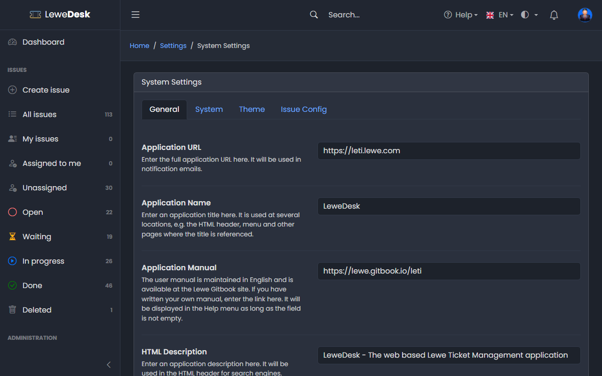

# Settings

<figure><figcaption></figcaption></figure>

The system settings are available to users with the permission `manage_settings`. Open them from the user menu in the top bar (_Settings_) or from **Administration** → **System** → **Settings**.

The page has four tabs. Click **Save** on a tab to store the changes. A setting that was never saved shows its default value.

## General

| Setting                            | Description                                                                                                                                       | Default                      |
| ---------------------------------- | ------------------------------------------------------------------------------------------------------------------------------------------------- | ---------------------------- |
| Application URL                    | The full URL of your installation. Used for the links in notification emails.                                                                     |                              |
| Application Name                   | Title of the application. Used in the HTML header, the menu, and as title, subject and sender name of notification emails.                        | LeweDesk                     |
| Application Manual                 | Link to a user manual. It is shown in the _Help_ menu as long as the field is not empty. Enter the link of your own manual if you wrote one.      |                              |
| HTML Description / HTML Keywords   | Description and keywords in the HTML header, for search engines                                                                                    |                              |
| Default Language                   | Language for visitors who did not choose one. Users can switch languages in the top bar. Notification emails use this language.                   | English                      |
| Show Alerts                        | Which kinds of alerts (toast messages) are shown: Info, Success, Warning, Error                                                                   | all                          |
| Close ... Alerts Automatically     | Whether Info, Success, Warning and Error alerts close by themselves                                                                               | Info, Success: yes           |
| Alert Autoclose Delay              | Time in milliseconds after which these alerts close (e.g. 4000 = 4 seconds)                                                                       | 3000                         |

## System

| Setting                | Description                                                                                                                             | Default       |
| ---------------------- | --------------------------------------------------------------------------------------------------------------------------------------- | ------------- |
| Timezone               | Default timezone of the application                                                                                                     | Europe/Berlin |
| Matomo Analytics       | Adds the Matomo tracking code to all pages. Enter the **Matomo URL** (e.g. `mysite.com/matomo`) and the **Matomo Site ID** below it.    | off           |
| Disable Search Engines | Tells search engine robots not to index the site                                                                                        | on            |
| Disable Caching        | Sends no-caching instructions. Try this if you see unwanted caching effects in your server environment.                                 | off           |
| Debug Mode             | Shows debugging information in the browser console                                                                                      | off           |
| Under Maintenance      | Puts the application into maintenance mode. Only administrators can access it, everybody else sees the maintenance page.               | off           |
| Force Two Factor Authentication | Forces users to set up two factor authentication, e.g. via Google or Microsoft Authenticator. A user who has not set up 2FA yet is sent to the setup page after the regular login. Sessions that are already open are not affected. See [Two Factor Authentication](../../user-guide/two-factor-authentication.md). | off |

## Theme

| Setting    | Description                                                                                          | Default |
| ---------- | ---------------------------------------------------------------------------------------------------- | ------- |
| Color Mode | Default color mode: Dark, Light or Auto. Users can switch modes in the top bar (see [Dark Mode](../../user-guide/dark-mode.md)). | Dark    |
| Font       | Font of the application: Default (your browser's sans-serif font), Poppins, Roboto, Lato, Montserrat or Open Sans | Poppins |

## Issue Config

| Setting                          | Description                                                                                                                                                  | Default |
| -------------------------------- | ------------------------------------------------------------------------------------------------------------------------------------------------------------ | ------- |
| Issue Key Prefix                 | Prefix of the issue key. Issues are displayed as `PREFIX-123`. 1-10 characters, A-Z and 0-9, starting with a letter.                                         | LETI    |
| Support Email                    | Address of your support team. It gets a message when an issue is created.                                                                                    |         |
| Maximum Attachment Size (MB)     | Maximum size of a single attachment or inline image (1-50)                                                                                                   | 2       |
| Maximum Attachments per Issue    | Maximum number of attachments of an issue (1-100). Inline images count.                                                                                      | 10      |
| Maximum Total Attachment Size per Issue (MB) | Maximum total size of all attachments of an issue (1-500)                                                                                        | 10      |
| Issues per Hour                  | How many issues a user may create per hour. `0` switches the limit off.                                                                                      | 10      |
| Comments per Hour                | How many comments a user may add per hour. `0` switches the limit off.                                                                                       | 30      |
| Notification Retention (Days)    | In-app notifications older than this are deleted                                                                                                             | 90      |
| Notification Poll Interval (Seconds) | How often the browser checks for new notifications (10-3600)                                                                                              | 60      |
| Audit Log Retention (Days)       | Entries of the [Audit Log](audit-log.md) older than this are deleted. `0` keeps them forever (0-3650). It is in the System tab, below Force Two Factor Authentication. | 365 |
| Temporary Upload Cleanup (Hours) | Images uploaded while writing a new issue are deleted after this many hours if the issue was never saved                                                      | 24      |


The **Issue Key Prefix** cannot be changed anymore once the first issue exists. Set it before you start.



The issue and comment limits do not apply to Agents and Administrators. The allowed attachment file types are fixed: pdf, txt, md, zip, jpg, gif and png. The PHP settings `upload_max_filesize` and `post_max_size` of your web server must allow the size you configure.


## Where are the email server settings?

The mail server credentials and the sender address are not part of the system settings. They are configured in the `.env` file on the server. See [Installation](../../installation.md).

## Two factor authentication: server configuration

Two values in the `.env` file of the server belong to two factor authentication (see [Two Factor Authentication](../../user-guide/two-factor-authentication.md)):

| Key | Description | Default |
| --- | ----------- | ------- |
| `TWOFA_ENCRYPTION_KEY` | The key that encrypts the secrets of the authenticator apps in the database. At least 32 random bytes, Base64 encoded. Create one with `node -e "console.log(require('crypto').randomBytes(32).toString('base64'))"`. Without a valid key nobody can set up or use 2FA. | none, set it before using 2FA |
| `DISABLE_ADMIN_2FA` | Emergency only. If `true`, all administrator accounts can log in without a code, even if 2FA is mandatory or set up. Every such login is written to the error log. | `false` |


Never change or lose `TWOFA_ENCRYPTION_KEY` once users have set up 2FA. The stored secrets can no longer be read, and every user has to be reset by an administrator. Keep a backup of the key, separate from the database backup, and use a different key for every installation.



`DISABLE_ADMIN_2FA=true` removes the second factor for all administrators. Use it only to get back in, for example when the only administrator lost the device, then reset the 2FA of that account and set the value back to `false`. Every login that uses the bypass is recorded in the [Audit Log](audit-log.md) (`auth.2fa_bypass`).

