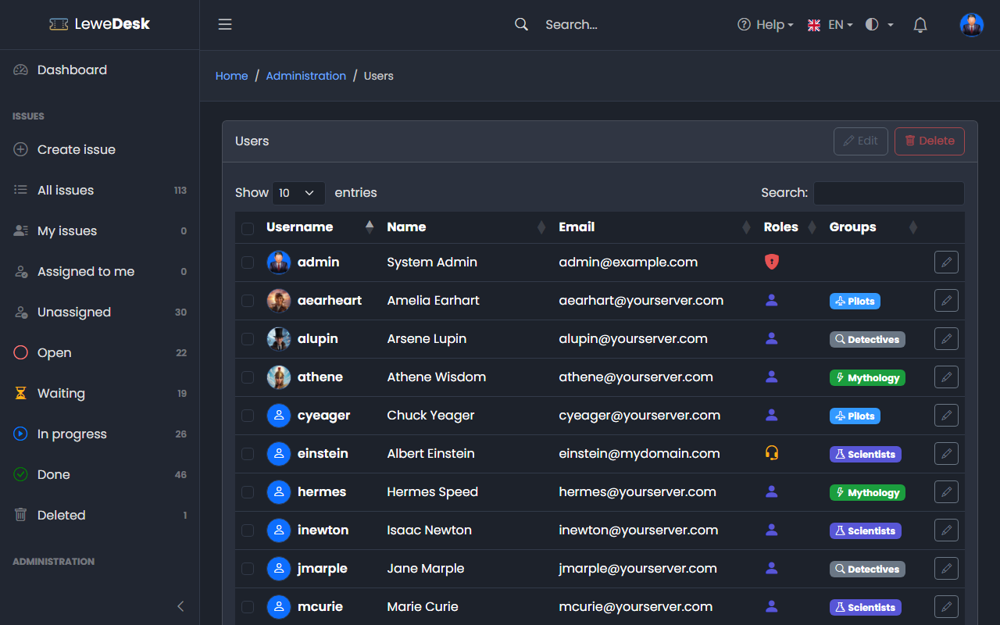
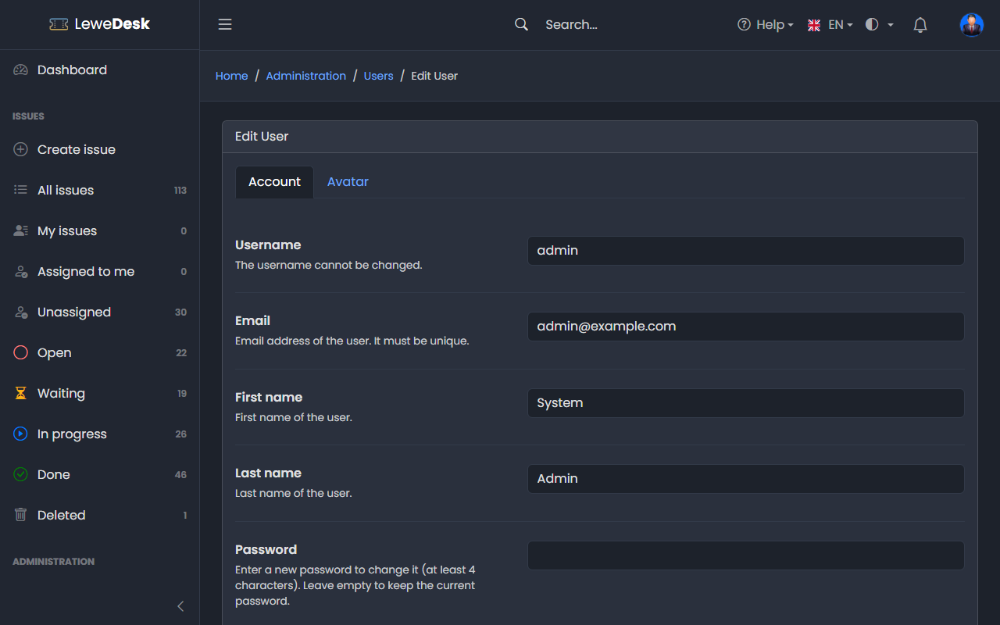

# Users

<figure><figcaption></figcaption></figure>

The list shows username, name, email, roles, groups and the two factor authentication status (shield icon) of every account.

Users create their own accounts on the registration page (see [Login and Registration](../../user-guide/login-registration.md)). Administrators then assign roles and groups here.

## Buttons

| Button | Function                                                             |
| ------ | -------------------------------------------------------------------- |
| Edit   | Opens the Edit page for the selected user (or the pencil in the row) |
| Delete | Deletes the selected users after a confirmation                      |

## Edit User

<figure><figcaption></figcaption></figure>

### Account tab

| Field      | Description                                                                                         |
| ---------- | --------------------------------------------------------------------------------------------------- |
| Username   | The username cannot be changed                                                                      |
| Email      | Email address of the user. It must be unique.                                                       |
| First name | First name of the user                                                                              |
| Last name  | Last name of the user                                                                               |
| Password   | Enter a new password to change it (at least 4 characters). Leave empty to keep the current password |
| Roles      | Roles assigned to the user. Hold Ctrl (Cmd) to select several.                                      |
| Groups     | Groups the user belongs to. Hold Ctrl (Cmd) to select several.                                      |
| Two factor authentication | Shows whether the user has set up 2FA. **Reset 2FA** switches it off (see below). |

### Avatar tab

Select the picture that is shown for the user. Users can also change their own avatar in their [profile](../../user-guide/profile.md).

## Resetting two factor authentication

If a user lost the device with the authenticator app, click **Reset 2FA** in the Account tab of the user and confirm. The user can then log in with the password only. If 2FA is mandatory (see [Settings](settings.md)), the user has to set it up again at the next login. Users can only set up 2FA for themselves.

The reset is recorded in the [Audit Log](audit-log.md) (`auth.2fa_reset`), with the administrator as the actor and the user as the target. The same goes for changes to an account (email, names, password, roles, groups) and for deleting it.

## Assigning issues: the role Agent

Only users with the role **Agent** can be assigned to issues. Give the role to every member of your support team. If a user loses the role Agent, their assignments are cleared.

## Deleting users

If a user is a participant in issues (as reporter, assignee, commenter or watcher), the confirmation dialog tells you how many. After the deletion their name is replaced with _Deleted user_ in these issues. The issues themselves stay.


Deleting a user cannot be undone.

