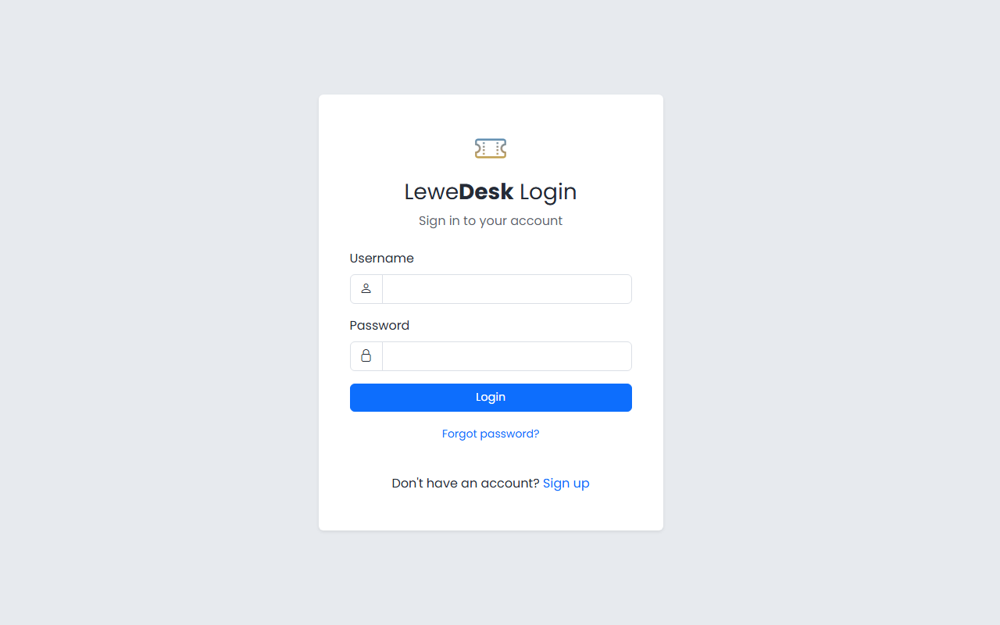
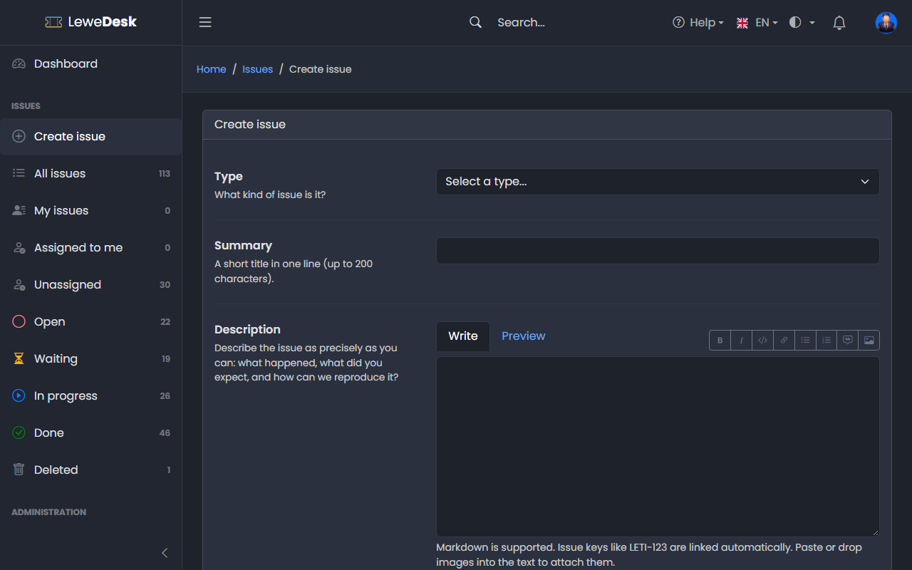
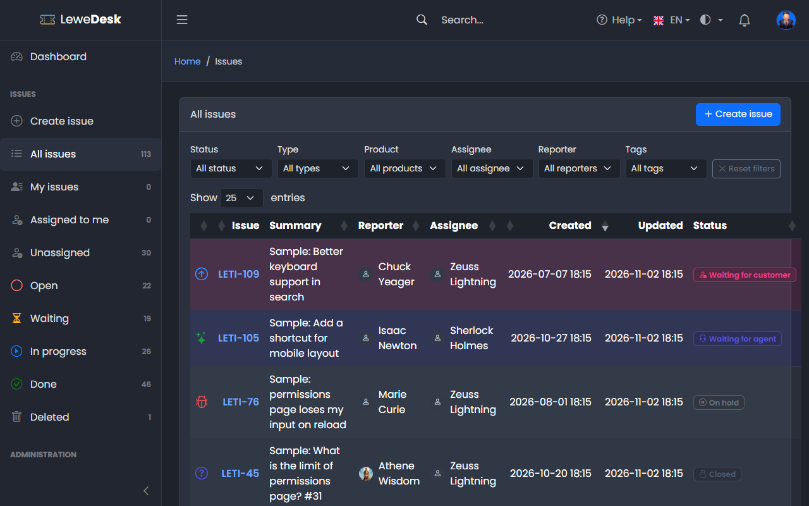

# Quick Start Guide

This guide takes you from the first login to a resolved issue in a few minutes.

## 1. Log in or register

Open LeweDesk in your browser. Public issues can be read without an account. To report an issue you need to log in.

<figure><figcaption></figcaption></figure>

Do you not have an account yet? Click the registration link on the login page. See [Login and Registration](user-guide/login-registration.md).

## 2. Create an issue

Click **Create issue** in the sidebar, select a type, enter a summary and a description and click **Create issue**.

<figure><figcaption></figcaption></figure>

The issue gets a key such as `LETI-123`. You and the support team are notified. See [Create Issue](user-guide/issues/create-issue.md).

## 3. Follow your issue

Open **My issues** in the sidebar to see the issues you reported. Open an issue to read comments and see its status. You can answer with **Actions** → **Respond** or by adding a comment.

<figure><figcaption></figcaption></figure>

## 4. For the support team: work on an issue

Agents see all issues. A typical flow looks like this:

1. Open **Unassigned** in the sidebar and open an issue
2. Click **Actions** → **Assign to me**
3. Click **Actions** → **Respond** to ask a question or answer. The status changes to _Waiting for customer_.
4. When the problem is solved, click **Actions** → **Resolve** and select a resolution. The status changes to _Resolved_.
5. The reporter (or you) closes the issue with **Actions** → **Close**

See [Issue Actions](user-guide/issues/issue-actions.md) for all actions.

## 5. For administrators: set up the system

* [Settings](administration/system/settings.md): application name, email, theme and issue limits
* [Users](administration/system/users.md), [Roles](administration/system/roles.md) and [Permissions](administration/system/permissions.md): who may do what
* [Products](administration/issues/products.md) and [Tags](administration/issues/tags.md): structure your issues
