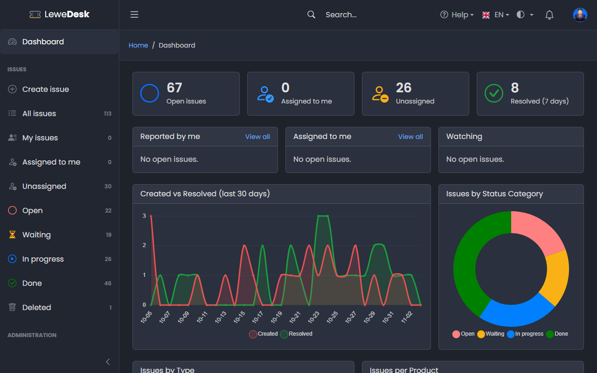

# User Guide

This guide explains how to work with issues in LeweDesk.

## The screen

<figure><figcaption></figcaption></figure>

* The **sidebar** on the left contains the dashboard, the issue list with its quick views and, for administrators, the administration pages. Click the menu icon at the top to collapse it.
* The **search field** in the top bar searches the issues (see [List Issues](issues/list-issues.md)).
* The **top bar menus** on the right: _Help_, language, color mode (see [Dark Mode](dark-mode.md) and [Language](language.md)), [notifications](notifications.md) and your user menu with [Profile](profile.md) and _Logout_.

## Roles

What you can do depends on your role:

| Role                | What it can do                                                                                          |
| ------------------- | ------------------------------------------------------------------------------------------------------- |
| Visitor (Public)    | Read _Public_ issues, their comments and attachments. Cannot create or change anything.                |
| User                | Create issues, comment, watch issues, close and reopen own issues, add attachments to own issues        |
| Agent               | Everything on all issues: assign, resolve, edit, delete, internal comments                              |
| Administrator       | Everything, plus the administration pages                                                               |

## Topics

* [Login and Registration](login-registration.md)
* [Dashboard](dashboard.md)
* [Issues](issues/README.md): list, create, read, act on, edit, comment, attach, history
* [Markdown](markdown.md): format your text
* [Notifications](notifications.md)
* [Profile](profile.md)
