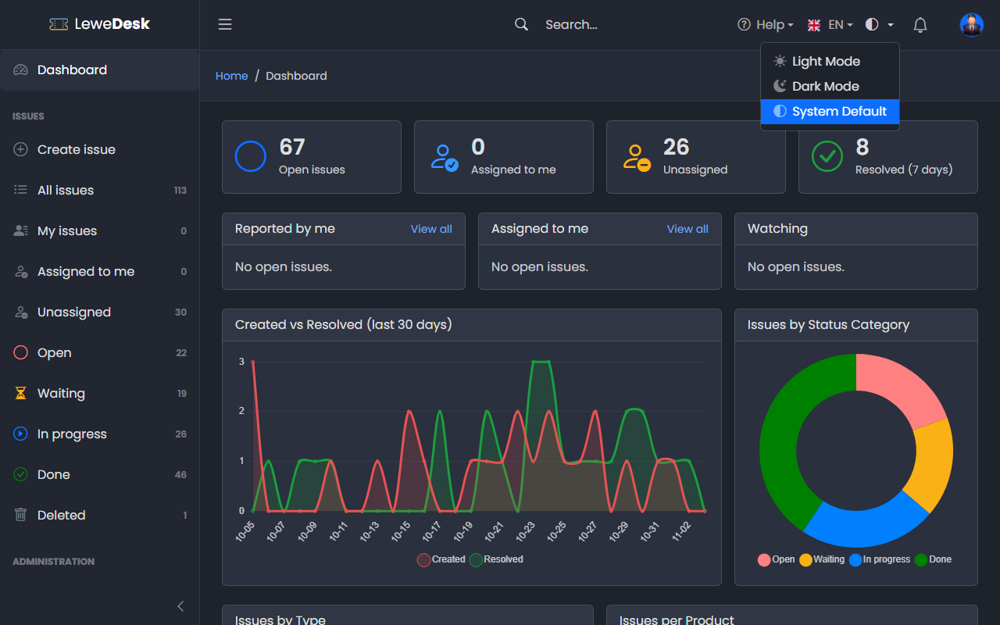
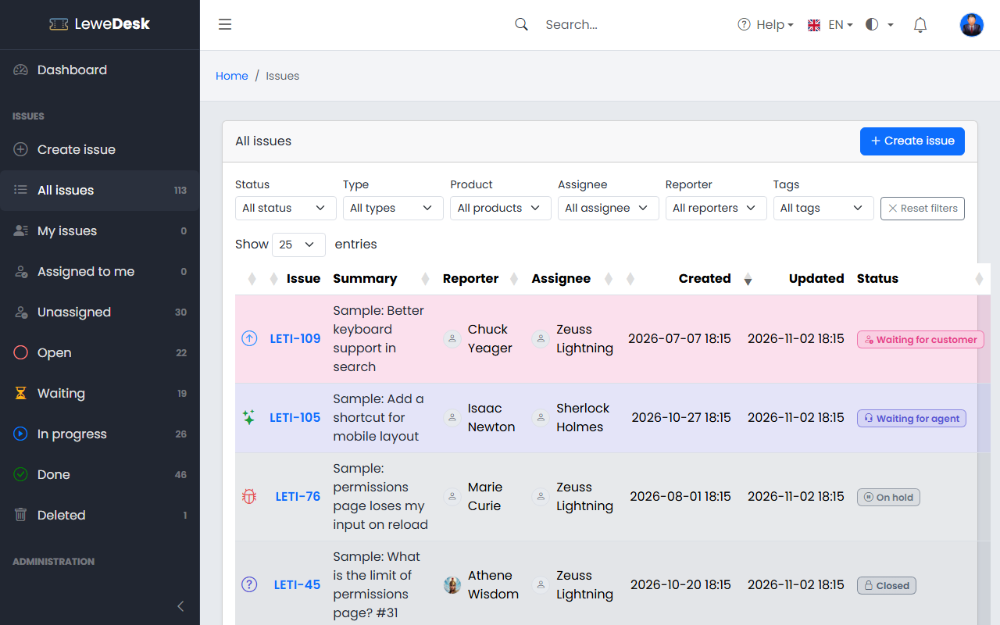
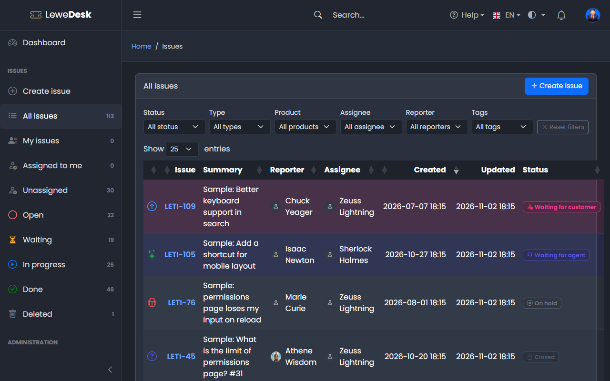

# Dark Mode

LeweDesk can be shown in a dark or a light color scheme. Use the theme switch in the top bar.

<figure><figcaption></figcaption></figure>

## Light Mode

Light Mode shows a light background with dark text.

<figure><figcaption></figcaption></figure>

## Dark Mode

Dark Mode shows a dark background with light text.

<figure><figcaption></figcaption></figure>

## Auto Mode

Auto Mode follows the setting of your computer or browser and switches between dark and light with it.


The administrator sets the default color mode in the [Settings](../administration/system/settings.md) (tab _Theme_). Your own choice in the top bar takes priority in your browser.

