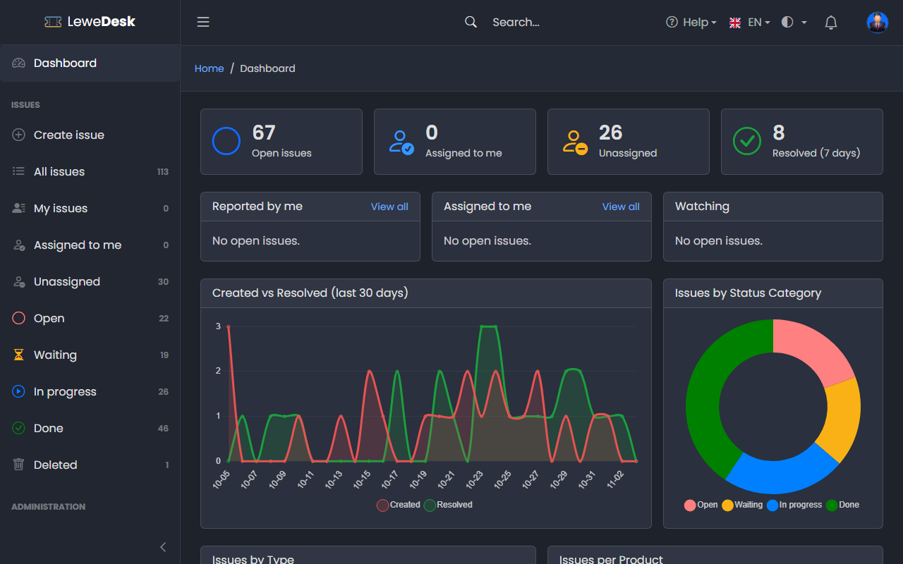

# Dashboard

<figure><figcaption></figcaption></figure>

The dashboard is the welcome page after login. It only shows issues you are allowed to see.

## Tiles

| Tile            | Meaning                                                              |
| --------------- | -------------------------------------------------------------------- |
| Open issues     | Issues that are not in the status category _Done_                    |
| Assigned to me  | Open issues assigned to you                                          |
| Unassigned      | Open issues nobody works on yet                                      |
| Resolved (7 days) | Issues resolved during the last seven days                         |

## Lists

| List            | Shows                                                                                   |
| --------------- | --------------------------------------------------------------------------------------- |
| Reported by me  | Your open issues. _View all_ opens the issue list.                                      |
| Assigned to me  | Open issues assigned to you                                                             |
| Watching        | Open issues you watch, except those you reported or work on                             |

## Charts

* **Created vs Resolved (last 30 days)**: issues created and resolved per day
* **Issues by Status Category**: a donut chart of the status categories
* **Issues by Type**
* **Issues per Product**

## Recent Activity

The latest changes and comments on issues you are involved in.
