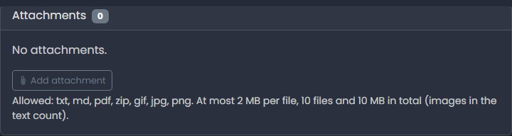

# Attachments

<figure><figcaption></figcaption></figure>

Files can be attached to an issue when it is created, or later.

## Limits

The following file types are allowed: **txt, md, pdf, zip, gif, jpg and png**. The size limits are configured by the administrator. The defaults are:

* 2 MB per file
* 10 files per issue
* 10 MB in total per issue

The limits are shown below the attachment list on every issue. If you exceed a limit, a message tells you so and the file is rejected. The content of a file must match its type.

## Adding attachments

* While creating an issue, use the attachment field of the form
* Later, click **Add attachment** in the attachment panel of the issue. The reporter can always add attachments to their own issue. Agents and Administrators can add to all issues. A closed or deleted issue takes no more attachments.

## Inline images

You can paste an image from the clipboard into a description or comment, or drag it into the text. The image is stored as an attachment of the issue and shown in the text. It is marked **Image in text** in the attachment list. Inline images count towards the limits.

Only the reporter, Agents and Administrators can add inline images to comments.

## Deleting

Click **Delete** next to an attachment. The uploader, Agents and Administrators can do this. If the attachment is shown as an image in the description or a comment, LeweDesk warns you: the image is then replaced by the note _Image removed_.

## Access

Attachments are only handed out to users who may see the issue. Attachments of internal comments are only visible to the support team.
