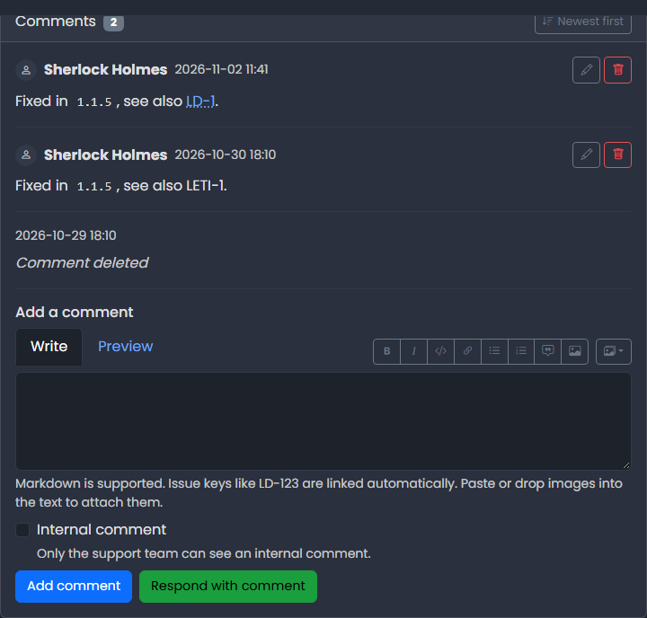

# Comments

<figure><figcaption></figcaption></figure>

Comments are the conversation about an issue.

## Adding a comment

Scroll to **Add a comment** at the bottom of the issue and write your text. Comments support [Markdown](../markdown.md). You can paste or drag images into the text (see [Attachments](attachments.md)). Below the text field there are up to two buttons:

| Button                   | Effect                                                                                      |
| ------------------------ | ------------------------------------------------------------------------------------------- |
| **Add comment**          | Adds the comment. The status of the issue does not change.                                  |
| **Respond with comment** | Adds the comment and changes the status to show who is expected to answer next (see below). |

### Respond with comment

**Respond with comment** is only shown when it makes sense:

* The reporter sees it when the issue is _Waiting for customer_. Responding sets the status to _Waiting for agent_.
* Agents and Administrators see it when the issue is _Waiting for agent_. Responding sets the status to _Waiting for customer_.

It is hidden while **Internal comment** is ticked, because an internal comment never changes the status.

It does the same as **Actions** → **Respond** (see [Issue Actions](issue-actions.md)), without opening a dialog.

Who may comment:

* Users: their own issues and _Public_ and _Registered_ issues
* Agents and Administrators: all issues
* Nobody can comment on a closed or deleted issue. Reopen it first.
* Visitors who are not logged in see a hint to log in.

## Internal comments

Agents and Administrators can tick **Internal comment**. Only the support team can see an internal comment, and it does not change the status or trigger customer notifications. Internal comments are marked **Internal**.

## Order

Use **Newest first** / **Oldest first** above the list to change the order. LeweDesk remembers your choice. The default is newest first.

## Editing and deleting

Each comment has **Edit** and **Delete** links.

* You can edit and delete your own comments. Agents and Administrators can edit and delete everybody's comments.
* A reporter can no longer edit or delete comments once the issue is _Resolved_ or _Closed_.
* An edited comment shows an **edited** marker with the date.
* A deleted comment is replaced by the note _Comment deleted_.


LeweDesk limits how many comments a user can add per hour (default 30) to protect against spam. Agents and Administrators are not limited.

