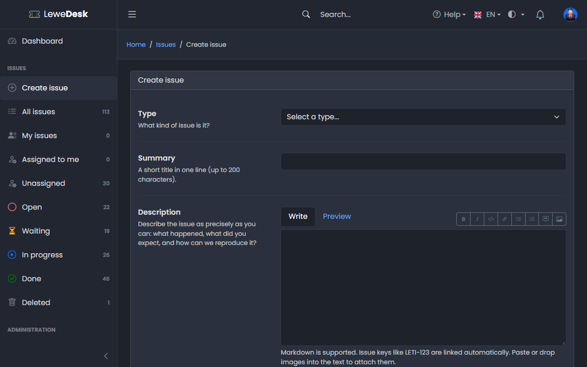
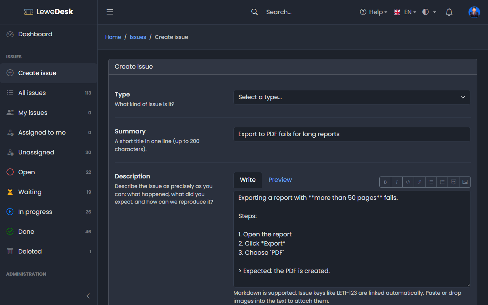
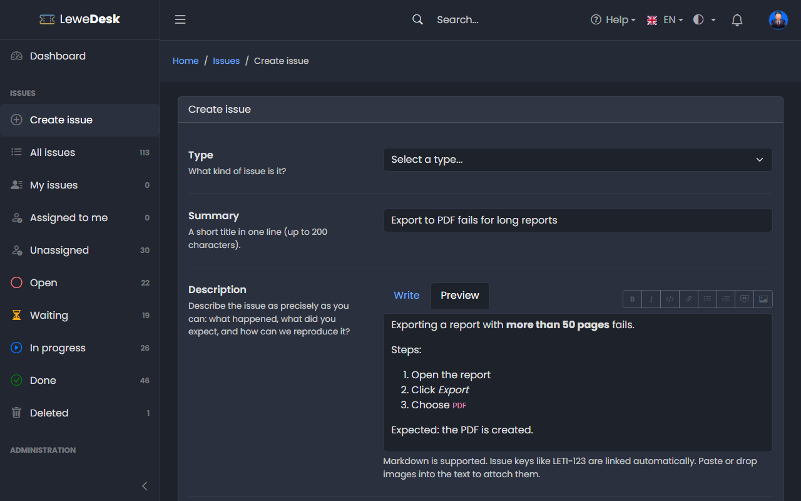

# Create Issue

<figure><figcaption></figcaption></figure>

Click **Create issue** in the sidebar. You need to be logged in.

## Fields

| Field       | Description                                                                                                                 |
| ----------- | --------------------------------------------------------------------------------------------------------------------------- |
| Type        | What kind of issue is it? Required.                                                                                         |
| Summary     | A short title in one line (up to 200 characters). Required.                                                                 |
| Description | Describe the issue as precisely as you can: what happened, what did you expect, and how can we reproduce it? Required. Supports [Markdown](../markdown.md) and pasted images. |
| Tags        | Optional. Type to search the existing tags. A tag that does not exist yet is created after you confirm.                    |
| Product     | The product the issue is about (optional)                                                                                   |
| Version     | The version of the product the issue occurs in (optional)                                                                   |
| Access      | Who may see this issue: _Public_, _Registered_ or _Reporter only_. The support team can always see it.                      |
| Attachments | Files to attach (optional). See [Attachments](attachments.md).                                                              |

Click **Create issue**. The issue gets its key (for example _Issue LETI-123 was created_).

## Writing the description

<figure><figcaption></figcaption></figure>

Use the toolbar above the text field for bold, italic, code, links, lists, quotes and images. Click **Preview** to see the formatted text. See [Markdown](../markdown.md).

<figure><figcaption></figcaption></figure>

## After creating

* You become a watcher of the issue and receive notifications about it
* The support team is notified, and the support email address configured by the administrator gets a message
* You cannot edit the summary or the description afterwards. Add a [comment](comments.md) for additions.


LeweDesk limits how many issues a user can create per hour (default 10) to protect against spam. Agents and Administrators are not limited.

