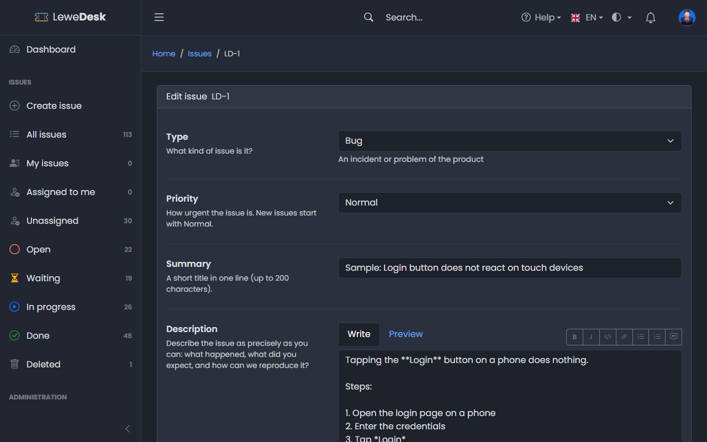

# Edit Issue

<figure><figcaption></figcaption></figure>

The Edit page is for the support team (permission `edit_issue`). Open it with **Actions** → **Edit**. Reporters cannot edit their issue after creating it. They add [comments](comments.md) instead.

## Fields

| Field       | Description                                                                                   |
| ----------- | --------------------------------------------------------------------------------------------- |
| Type        | Kind of issue                                                                                 |
| Priority    | How urgent the issue is. Required.                                                            |
| Status      | The status can be set freely. A status of the category _Done_ needs a resolution.             |
| Resolution  | Why the issue is done. Required for a status of the category _Done_.                          |
| Assignee    | Only users with the role _Agent_ can be assigned                                              |
| Summary     | Title of the issue                                                                            |
| Description | Description in [Markdown](../markdown.md)                                                     |
| Product     | The product the issue is about                                                                |
| Version     | The product version                                                                           |
| Access      | Who may see the issue. Watchers who lose access are removed.                                  |
| Tags        | Labels of the issue                                                                           |

Click **Save changes**. If nothing was changed, LeweDesk tells you so. Every change is recorded in the [History](history.md).


Changing the status here bypasses the normal flow of the [Issue Actions](issue-actions.md). You can also change the status directly in the [properties](issue-detail.md#change-the-status) of the issue. When the status leaves the category _Done_, the resolution is cleared (except when moving from _Resolved_ to _Closed_).

