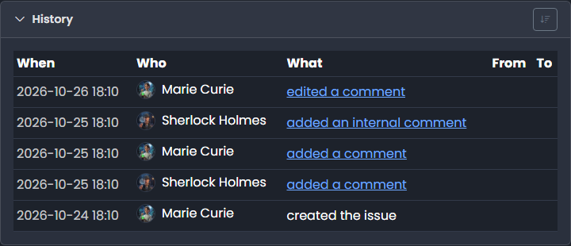

# History

<figure><figcaption></figcaption></figure>

The **History** panel at the bottom of an issue records who changed what and when. Click the title to expand or collapse it.

## Columns

| Column | Description                                                       |
| ------ | ----------------------------------------------------------------- |
| When   | Date and time of the change                                       |
| Who    | The user who made the change                                      |
| What   | What happened, e.g. _changed Status_ or _added a comment_         |
| From   | The previous value                                                |
| To     | The new value                                                     |

Click the sort icon to switch between newest first and oldest first.

## What is recorded

* creating, deleting and restoring the issue
* changes to type, priority, status, resolution, assignee, access, summary, description, product, version and tags
* comments added, edited and deleted (internal comments are only visible to the support team)
* attachments added and deleted
