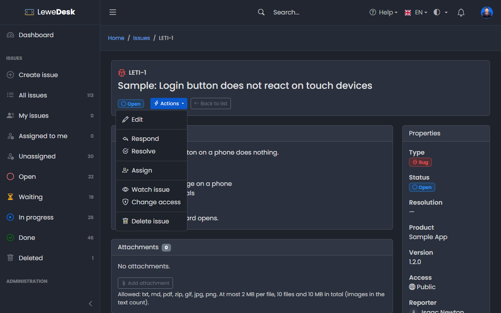
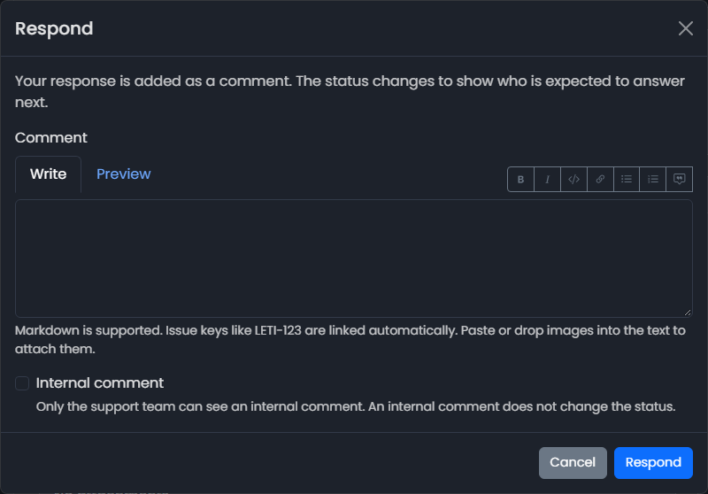
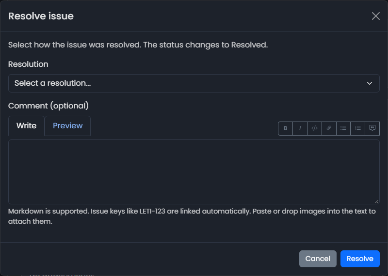
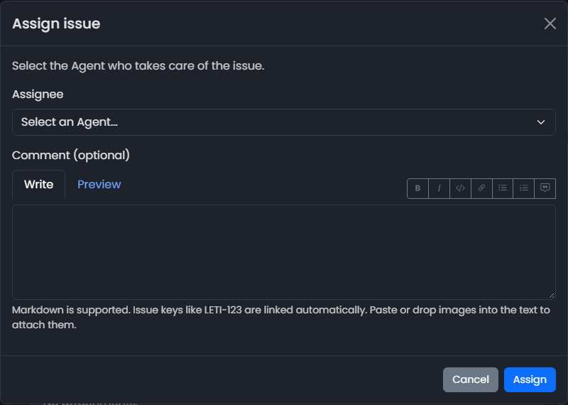
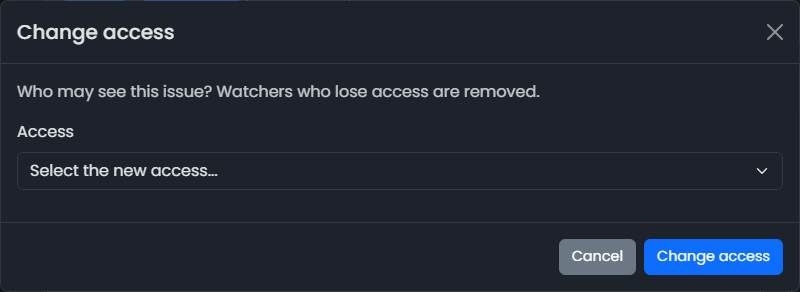

# Issue Actions

<figure><figcaption></figcaption></figure>

The **Actions** button on an issue opens a menu. It only lists the actions that you may perform on this issue at this moment. Some actions open a dialog where you add a comment or make a selection.

## Overview

| Action          | Who                                                                  | When                                    | Effect                                                                                     |
| --------------- | -------------------------------------------------------------------- | --------------------------------------- | ------------------------------------------------------------------------------------------ |
| Edit            | Agents, Administrators                                               | always                                  | Opens the [Edit Issue](edit-issue.md) page                                                 |
| Respond         | Everybody who may comment                                            | status is not Resolved or Closed        | Adds a comment and changes the status (see below)                                          |
| Resolve         | Agents, Administrators                                               | status is not Resolved or Closed        | Sets the resolution and the status _Resolved_                                              |
| Close           | Reporter, Agents, Administrators                                     | status is Resolved                      | Sets the status _Closed_                                                                   |
| Reopen          | Reporter, Agents, Administrators                                     | status is Resolved or Closed            | Adds a comment, sets the status _Open_ and clears the resolution                           |
| Assign          | Agents, Administrators                                               | always                                  | Assigns the issue to an Agent                                                              |
| Assign to me    | Agents                                                               | not yet assigned to you                 | Assigns the issue to you                                                                   |
| Watch issue     | Logged in users                                                      | you do not watch it yet                 | You get notifications about the issue                                                      |
| Unwatch issue   | Logged in users                                                      | you watch the issue                     | You stop getting notifications                                                             |
| Change access   | Reporter, Agents, Administrators                                     | always                                  | Changes who may see the issue                                                              |
| Delete issue    | Agents, Administrators                                               | always                                  | Hides the issue from everybody but the support team                                        |
| Restore issue   | Agents, Administrators                                               | issue is deleted                        | Brings a deleted issue back                                                                |

## Respond

<figure><figcaption></figcaption></figure>

Enter a comment (mandatory) and click **Respond**. The comment is added to the issue. The status changes to show who is expected to answer next:

| Who responds                  | New status           |
| ----------------------------- | -------------------- |
| The reporter                  | Waiting for agent    |
| An Agent or Administrator     | Waiting for customer |
| Anybody else                  | no change            |

Agents can tick **Internal comment**. An internal comment is only visible to the support team and does not change the status.


The comment form at the bottom of the issue has a **Respond with comment** button that does the same without opening a dialog. See [Comments](comments.md).


## Resolve

<figure><figcaption></figcaption></figure>

Select the resolution (mandatory) and optionally add a comment. The status changes to _Resolved_. The reporter is notified and can **Close** the issue to accept the solution or **Reopen** it.

## Close

Sets the status to _Closed_. A closed issue takes no more comments and attachments. The resolution is kept. To continue, use **Reopen**.

## Reopen

Say why the issue is reopened (mandatory). The status changes to _Open_ and the resolution is cleared.

## Assign

<figure><figcaption></figcaption></figure>

Select the Agent who takes care of the issue and optionally add a comment. Only users with the role _Agent_ can be assigned. Select _Unassigned_ to remove the assignment.

## Change access

<figure><figcaption></figcaption></figure>

Select who may see the issue. Watchers who lose access are removed.


A reporter can only restrict the access of their issue (Public → Registered → Reporter only), not widen it again. Agents and Administrators can select any value.


## Delete and restore

Deleting is a soft delete: the issue is only hidden. Attachments are kept. Deleted issues are listed in the quick view **Deleted** (see [List Issues](list-issues.md)), where they can be restored.
