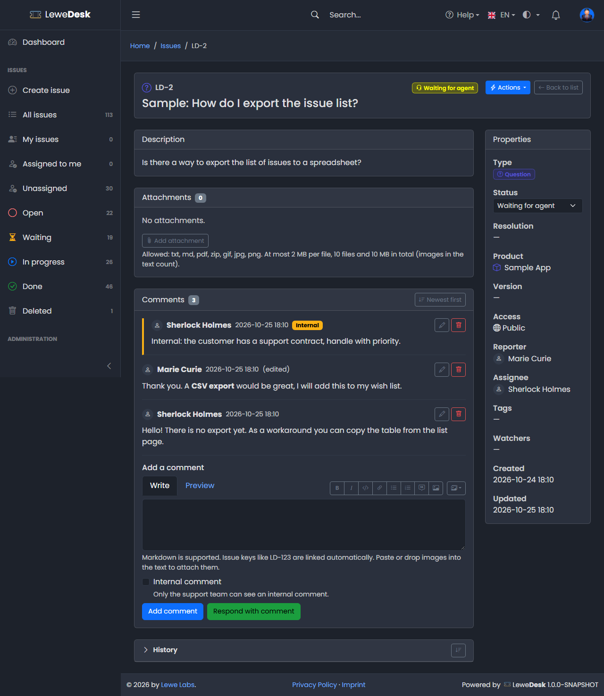
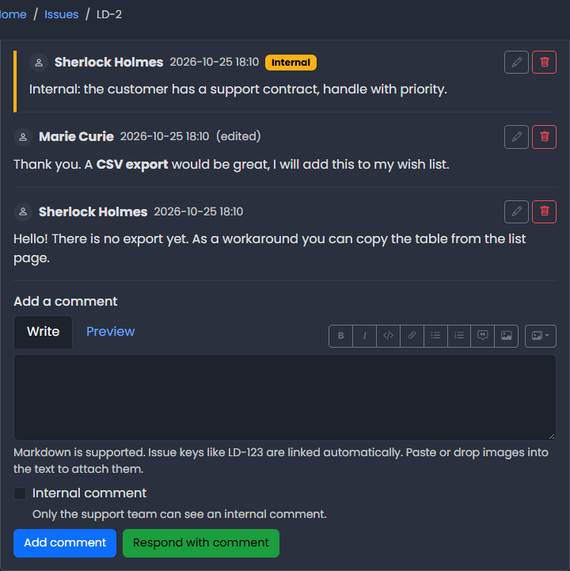
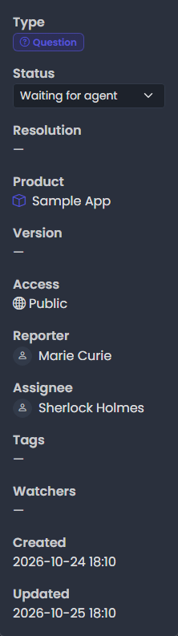
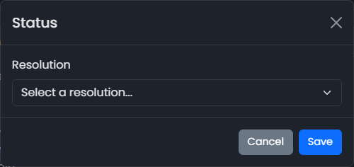

# Issue Detail

<figure><figcaption></figcaption></figure>

Click an issue key in the list to open the issue.

## Header

The header shows the issue type icon, the key, the summary and the current status (and the resolution, once resolved). The **Actions** button offers everything you may do with the issue (see [Issue Actions](issue-actions.md)). **Back to list** returns to the issue list.

## Description

The description as written by the reporter, rendered from [Markdown](../markdown.md). Issue keys in the text are links.

## Attachments

Files attached to the issue. See [Attachments](attachments.md).

## Comments

The conversation about the issue, and the form to add a comment. See [Comments](comments.md).

<figure><figcaption></figcaption></figure>

## History

A collapsible table of all changes. See [History](history.md).

## Properties

The panel on the right shows type, status, resolution, product, version, access, reporter, assignee, tags, watchers, and the dates created and updated. The product is shown with its icon in the color of the product.

<figure><figcaption></figcaption></figure>

### Change the status

For the support team (users who may change the issue status) the status in the properties is a drop-down list. Select a status to change it right away. The change is added to the [history](history.md).

If the status belongs to the category _Done_, LeweDesk asks for the resolution first.

<figure><figcaption></figcaption></figure>

Select the resolution and click **Save**. If you cancel the dialog, the status stays as it was. Everybody else sees the status as a label.


The drop-down changes the status directly and bypasses the normal flow of the [Issue Actions](issue-actions.md). For the usual steps (respond, resolve, close, reopen) use the **Actions** menu.



If you open an issue that does not exist, or that you may not see, LeweDesk shows the same message in both cases: _The issue does not exist, or you are not allowed to see it._

