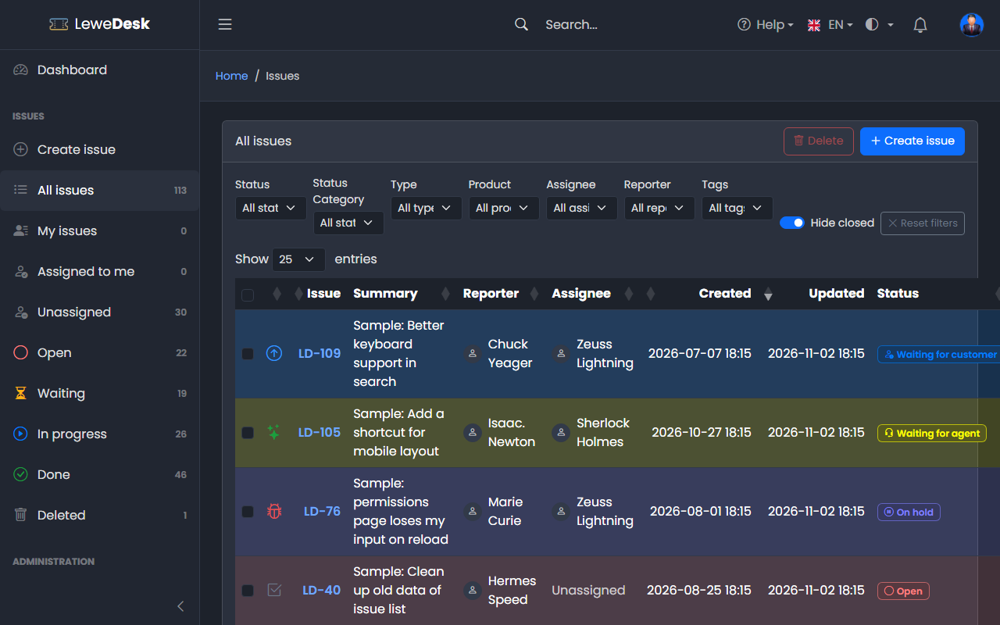
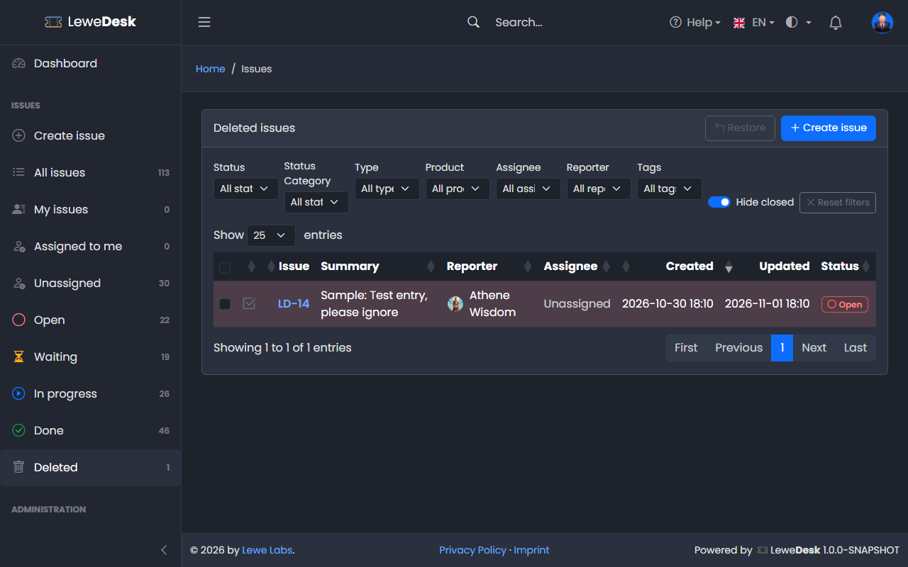
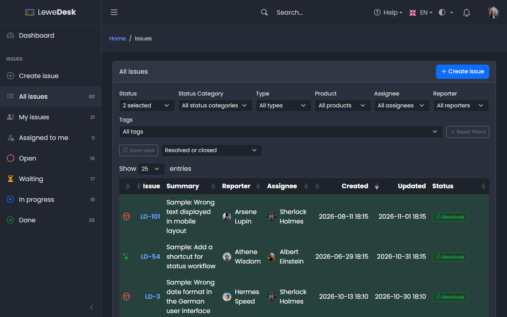
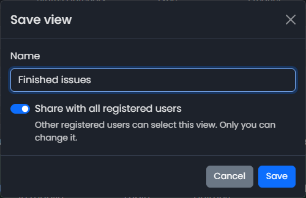
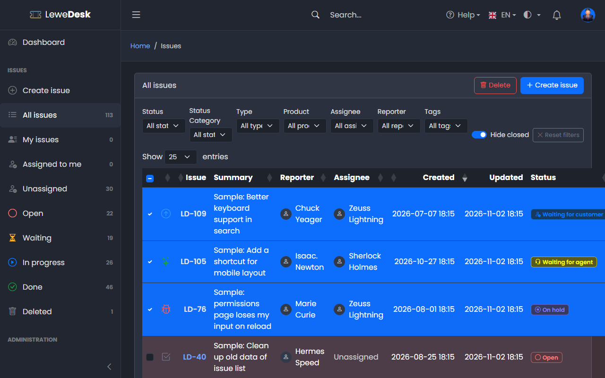
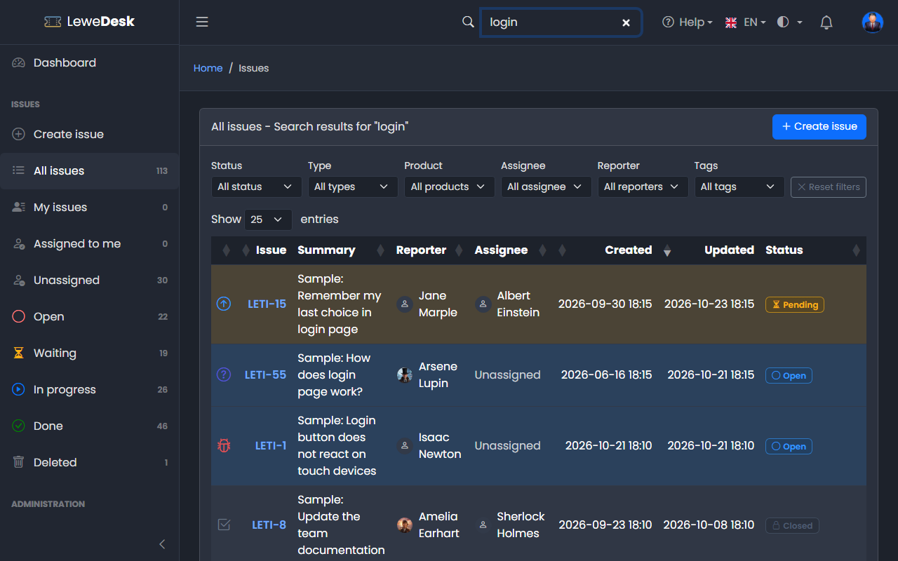

# List Issues

<figure><figcaption></figcaption></figure>

The issue list shows the issues you may see. Click an issue key to open the issue.

## Columns

| Column   | Description                                                      |
| -------- | ---------------------------------------------------------------- |
| (checkbox) | Selects the issue for [bulk actions](#delete-or-restore-several-issues) (only for users who may delete issues) |
| (icon)   | Icon of the issue type                                           |
| Issue    | The issue key, e.g. LD-123                                     |
| Summary  | Title of the issue                                               |
| Reporter | Who created the issue                                            |
| Assignee | Who works on it, or _Unassigned_                                 |
| Created  | Date and time of creation                                        |
| Updated  | Date and time of the last change. The list is sorted by this column, newest first. |
| Status   | Current status                                                   |

Click a column header to sort. Each row gets the background color of the issue's status. You can turn this off in your [profile](../profile.md) (_Options_).

## Quick views

The sidebar offers quick views. The number shows how many issues the view holds.

| View           | Shows                                                       |
| -------------- | ----------------------------------------------------------- |
| All issues     | All issues you may see                                      |
| My issues      | Issues you reported (logged in users)                       |
| Assigned to me | Issues assigned to you (logged in users)                    |
| Unassigned     | Issues nobody is assigned to                                |
| Open           | Issues of the status category _Open_                        |
| Waiting        | Issues of the status category _Waiting_                     |
| In progress    | Issues of the status category _In progress_                 |
| Done           | Issues of the status category _Done_                        |
| Deleted        | Deleted issues (only for users who may delete issues)       |

<figure><figcaption></figcaption></figure>

## Filters

Above the table you can narrow the list down by **Status**, **Status category**, **Type**, **Product**, **Assignee**, **Reporter** and **Tags**. Filters combine with the quick view. **Show entries** sets the page size.

The **Hide closed** switch is on by default and leaves out the issues with the status _Closed_, so that the list shows what still needs attention. Turn it off to see them as well. It has no effect when you choose a status in the **Status** filter.

Click **Reset filters** to remove all filters. This also turns **Hide closed** on again.

## Custom views

Logged in users can save a combination of filters as a **custom view** and use it again later. Visitors who are not logged in do not see the buttons described here.

Under the filters you find the **Save view** button and the **Select view** list.

<figure><figcaption></figcaption></figure>

### Save a view

1. Set the filters you want (**Status**, **Status category**, **Type**, **Product**, **Assignee**, **Reporter**, **Tags**).
2. Click **Save view**.
3. Enter a **Name** (up to 100 characters). Switch on **Share with all registered users** if other users should be able to use the view as well. A view is private by default.
4. Click **Save**.

<figure><figcaption></figcaption></figure>

A view stores these seven filters only. The quick view, the search term, the sort order and the page size are not part of it. You may save a view without any filter. It then shows all issues.

If you already have a view with the same name (upper and lower case do not matter), LeweDesk asks whether you want to **overwrite** it with the current filters.

### Use a view

Choose a view in **Select view**. Your own views are listed first, sorted by name, then a separator and the views other users have shared with you. A shared view shows the name of its owner, for example _Unassigned (Athene Wisdom)_.

The filters are replaced by the filters of the view and the list is reloaded. The address of the page contains the view (`customview=...`), so you can bookmark it. As soon as you change a filter or click **Reset filters**, the list no longer shows the view and **Select view** is reset.

If a view contains a filter value that does not exist anymore (for example a tag that was deleted), the value is ignored. The owner of the view gets a message and can repair the view in the [profile](../profile.md#custom-views-tab).

Only the owner can change or delete a view. Shared views of other users can be used, not changed.

## Delete or restore several issues

Users who may delete issues (Agents and Administrators) see a checkbox in front of every row. Tick the issues you want to change, or tick the box in the table header to select all issues of the page. Then click **Delete** above the table and confirm.

<figure><figcaption></figcaption></figure>

The issues are moved to the _Deleted_ quick view. Deleting works one issue at a time in the background, so the same rules apply as for [Delete issue](issue-actions.md) on a single issue, and each issue gets its entry in the history. A message tells you how many issues were deleted and how many could not be changed.

In the _Deleted_ quick view the **Delete** button is replaced by **Restore**. Select the issues and click **Restore** to bring them back.

## Search

Type a term into the **Search** field in the top bar and press Enter. LeweDesk searches the summary, the description, the product and the comments of the issues you may see. Internal comments are only searched for the support team.

<figure><figcaption></figcaption></figure>

The list title shows what you searched for. Click **Reset filters** to leave the search.
