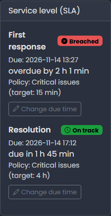
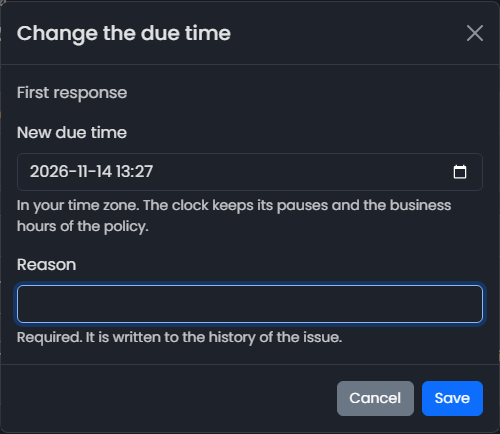
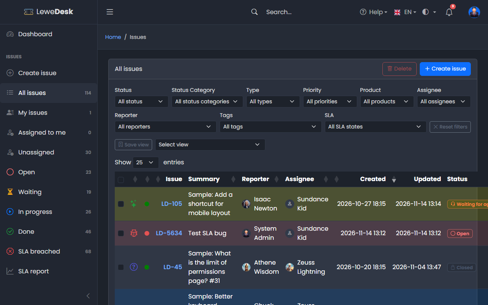

# SLA

An SLA (service level agreement) sets how fast an issue must get a first response and be resolved. LeweDesk measures this for each issue, shows how much time is left, warns before a target is missed and records breaches for the [SLA report](../sla-report.md). Administrators set the targets in [SLA Policies](../../administration/issues/sla-policies.md).

SLA data is for the support team. You see it if you have the permission `view_sla` (Agents and Administrators have it by default). Reporters and visitors see nothing about SLA.

## The SLA panel

<figure><figcaption></figcaption></figure>

The panel **Service level (SLA)** on the [issue detail](issue-detail.md) page shows one line per metric, _First response_ and _Resolution_:

| Part | Meaning |
| ---- | ------- |
| State | A badge with an icon: green _On track_, amber _At risk_, red _Breached_, grey _Paused_, a check mark for _Met_ |
| Due | The due time, in **your time zone and language** |
| Time left | For example _due in 2 h 15 min_ or _overdue by 31 min_. It is counted against the due time on the wall clock and updates every 30 seconds. The page changes to _Breached_ by itself when the time runs out. |
| Policy and target | The policy that applies and its target |

* A timer that is **paused** (the issue has a status that stops the clock) shows the working time that is left and _clock stopped_.
* A timer that is **met** shows when it was met and whether it was _in time_ or _late by_ some time.
* A timer whose due time was changed by hand shows _Due time changed by hand_.

The panel is hidden when the issue has no timers, for example because it was created before a policy was active or no policy has a target for it.

### Change the due time

Users with the permission `manage_sla` see the button **Change due time** next to a running timer. Use it when you agree a different deadline with the customer.

<figure><figcaption></figcaption></figure>

1. Click **Change due time**.
2. Enter the **New due time** in your time zone.
3. Enter a **Reason** (required, one line, up to 255 characters).
4. Click **Save**.

LeweDesk stores the new due time as a target in working time. The pauses and the opening hours of the policy still apply. The reason is written to the internal [history](history.md) of the issue and to the [Audit Log](../../administration/system/audit-log.md). A timer that is met, paused or cancelled cannot be changed.

## What counts as a response

The clock of the **first response** stops with the first **public comment** of an agent who is not the reporter. These do not count:

* internal comments
* comments of the reporter
* a comment of the agent who created the issue on behalf of a customer
* a change of status or assignee without a comment

A reply by [email](by-email.md) counts like a comment in the application. When an issue is resolved before a first response was given, the first response is met as well.

The clock of the **resolution** stops when the issue enters a status of the category _Done_. Reopening the issue starts a new resolution timer with the full target. The earlier result and breach stay on record.

## SLA in the issue list

<figure><figcaption></figcaption></figure>

* The column **SLA** shows the most urgent open timer of each issue: breached, at risk, on track or paused, with the earliest due time first. A check mark means all timers are met. Issues without timers show nothing.
* The filter **SLA** accepts several states: _Breached_, _At risk_, _Due today_, _On track_ and _Paused_. An issue matches when any of its open timers is in one of the chosen states. The chosen states are part of the address of the page (`sla_state=breached,at_risk`) and of a [custom view](list-issues.md#custom-views).
* Click the header of the column **SLA** to sort by the earliest due time. Issues without an open timer come last in both directions.
* The quick view **SLA breached** in the sidebar lists all issues with a breached timer. The number shows how many there are.

## Notifications

LeweDesk tells the assignee and the watchers when a timer becomes **at risk** and when it is **breached**, once per timer, in the application and by email. For a breach the escalation user and group of the policy are told as well. You can switch both events on or off per channel in your [notification settings](../notifications.md). Messages can be up to five minutes late.
