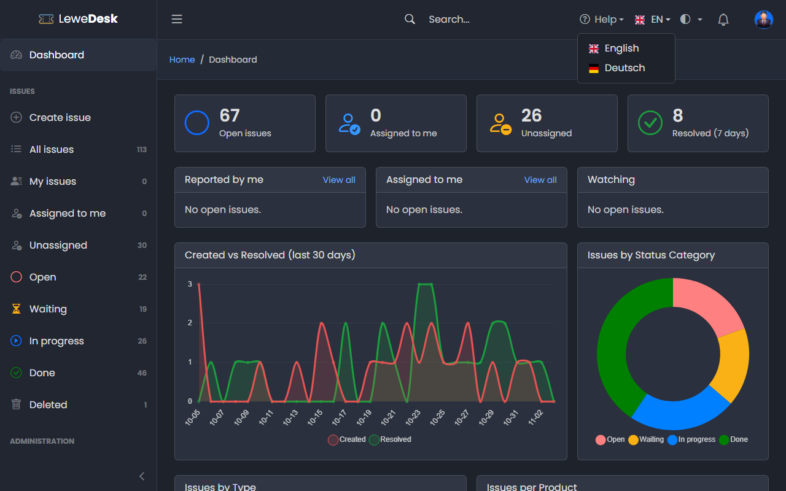

# Language

LeweDesk is available in **English** and **German**.

<figure><figcaption></figcaption></figure>

Click the language in the top bar (the flag and the language code) and select a language. The page switches immediately.

## What is translated

* The user interface
* The names of the system records (issue types, status, status categories and resolutions)

Records you create yourself (your own tags, products, status and so on), issue content and comments are shown as they were written and are not translated.

## Default language

The administrator sets the default language for visitors who did not choose one in the [Settings](../administration/system/settings.md) (tab _General_). Notification emails are sent in the default language.
