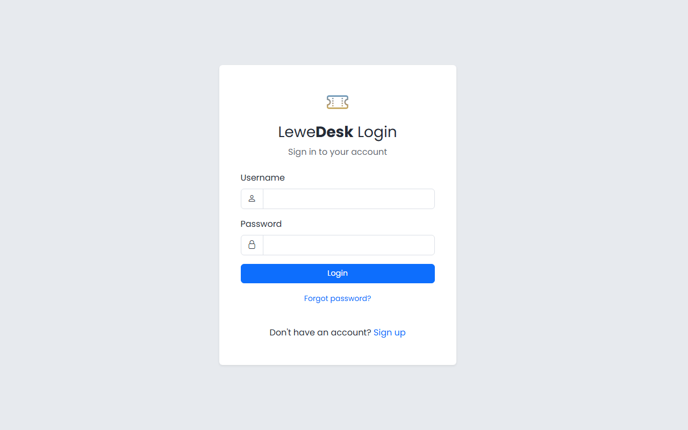
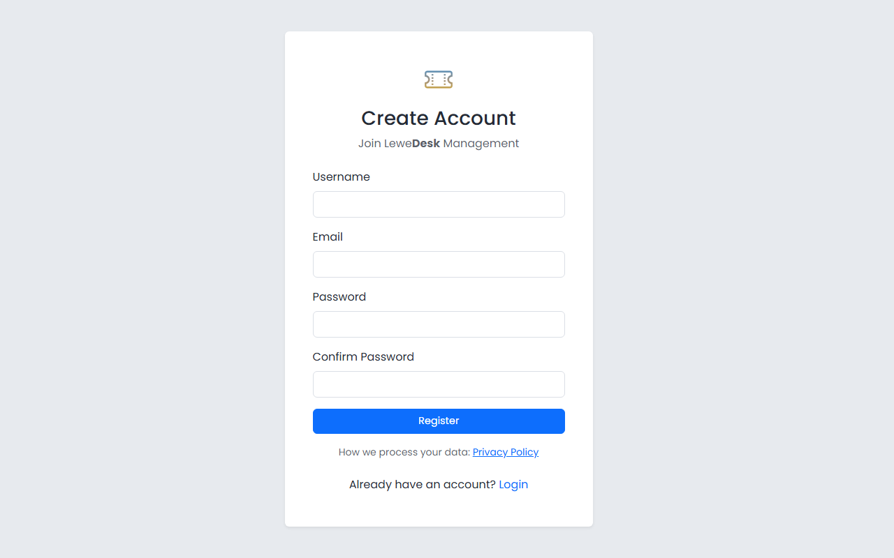
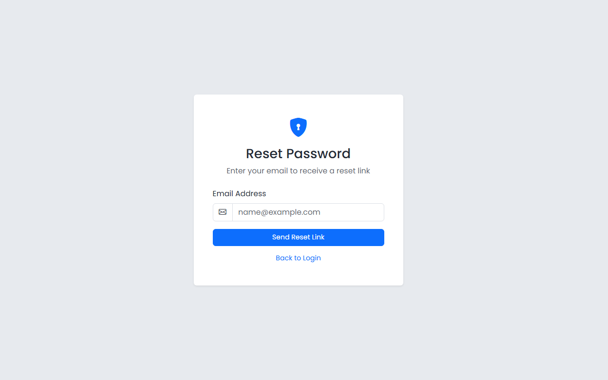

# Login and Registration

## Login

<figure><figcaption></figcaption></figure>

Enter your username and password and click **Login**. Use _Logout_ in the user menu in the top bar when you are done.

If you have set up two factor authentication, a second page asks for the 6-digit code of your authenticator app. If your administrator made it mandatory and you have not set it up yet, you are taken to the setup page. See [Two Factor Authentication](two-factor-authentication.md).

If your session expires, LeweDesk takes you back to the login page.

## Registration

<figure><figcaption></figcaption></figure>

If you do not have an account, click the registration link on the login page and fill in:

| Field            | Description                       |
| ---------------- | --------------------------------- |
| Username         | Your login name. It cannot be changed later. |
| Email            | Your email address. It must be unique. Notifications are sent here. |
| Password         | Your password                     |
| Confirm Password | Repeat the password               |

Click **Register**. New accounts get the role _User_. An administrator can give you more roles (see [Users](../administration/system/users.md)).

## Forgot your password?

<figure><figcaption></figcaption></figure>

Click the password reset link on the login page and enter your email address. LeweDesk sends you an email with a link. The link opens a page where you choose a new password.

You can also change your password any time in your [Profile](profile.md).
