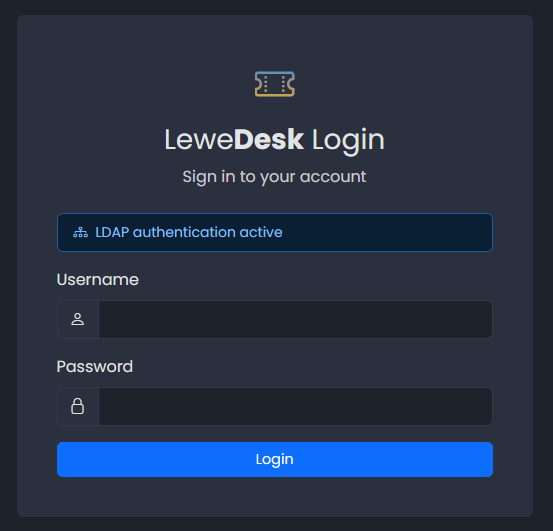
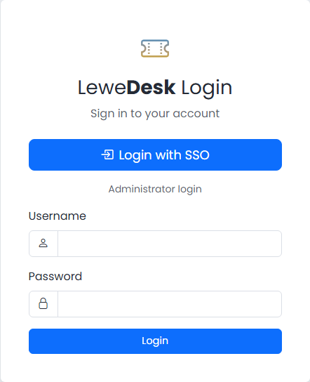

# Login and Registration

## Login

<figure><figcaption></figcaption></figure>

Enter your username and password and click **Login**. Use _Logout_ in the user menu in the top bar when you are done.

If you have set up two factor authentication, a second page asks for the 6-digit code of your authenticator app. If your administrator made it mandatory and you have not set it up yet, you are taken to the setup page. See [Two Factor Authentication](two-factor-authentication.md).

If your session expires, LeweDesk takes you back to the login page.

If the installation has no valid license, **Sign up** shows the message _This feature is currently disabled due to an invalid license._ Ask your administrator for an account. (If the administrator has locked the application, the login page may also say that only administrators can log in until the license is renewed.) See [License](../administration/system/license.md).

<figure><figcaption></figcaption></figure>

If the login page says _LDAP authentication active_, use your LDAP password (the one you use for your computer or other company systems). Your account must have been created by an administrator. The registration and the password reset are not available then. If the login says _Unknown LeweDesk user._, ask your administrator for an account. See [LDAP Authentication](../administration/system/ldap-authentication.md).

If the login page has a **Login with SSO** button, click it and sign in at your company's identity provider. The username and password form below it, labeled _Administrator login_, is only for the administrator. Your account must have been created by an administrator with the same username as at the identity provider; otherwise you see _Unknown LeweDesk user._ The registration and the password reset are not available, and two factor authentication is handled by the identity provider. Logging out of LeweDesk does not end your session at the identity provider. See [OIDC Authentication](../administration/system/oidc-authentication.md).

<figure><figcaption>Login page with SSO</figcaption></figure>

## Registration

<figure><figcaption></figcaption></figure>

If you do not have an account, click the registration link on the login page and fill in:

| Field            | Description                       |
| ---------------- | --------------------------------- |
| Username         | Your login name. It cannot be changed later. |
| Email            | Your email address. It must be unique. Notifications are sent here. |
| Password         | Your password                     |
| Confirm Password | Repeat the password               |

Click **Register**. New accounts get the role _User_. An administrator can give you more roles (see [Users](../administration/system/users.md)).

## Forgot your password?

<figure><figcaption></figcaption></figure>

Click the password reset link on the login page and enter your email address. LeweDesk sends you an email with a link. The link opens a page where you choose a new password.

You can also change your password any time in your [Profile](profile.md).
