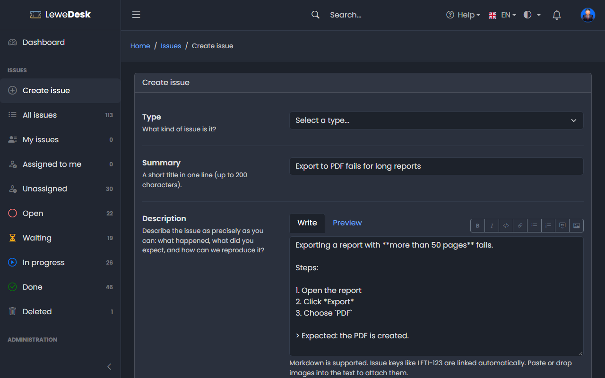
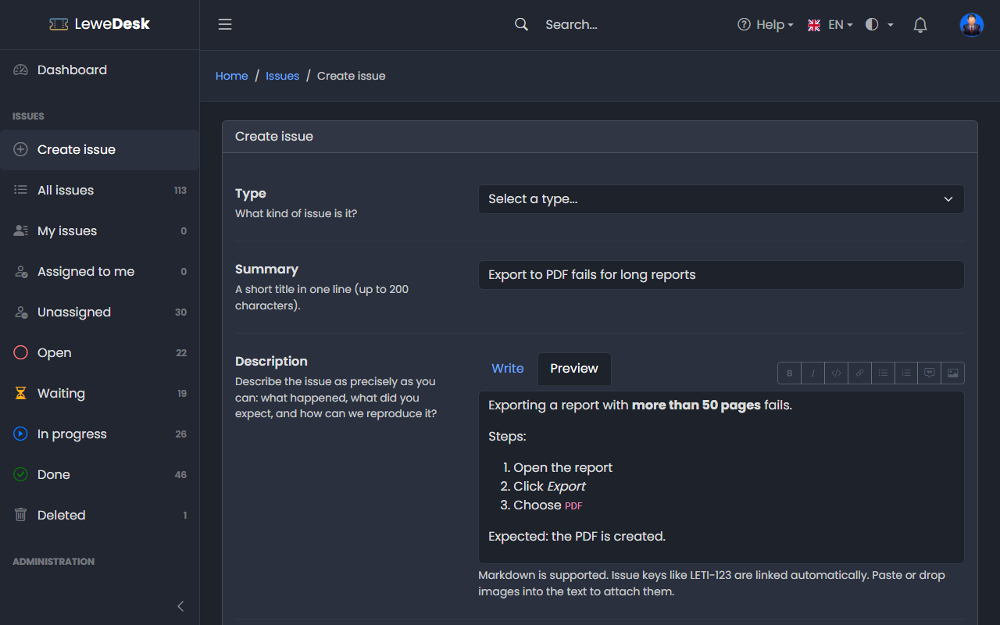

# Markdown

Descriptions and comments support Markdown, a simple way to format text. Use the toolbar above the text field, or type the Markdown yourself.

<figure><figcaption></figcaption></figure>

## Toolbar

| Button        | Result                                                           |
| ------------- | ---------------------------------------------------------------- |
| **B**         | Bold                                                             |
| _I_           | Italic                                                           |
| `</>`         | Code                                                             |
| Link          | Inserts a link                                                   |
| Bulleted list | Inserts a bulleted list                                          |
| Numbered list | Inserts a numbered list                                          |
| Quote         | Inserts a quote                                                  |
| Image         | Inserts an image. You can also insert an existing image of the issue. |

Click **Preview** to see the result, and **Write** to go back to editing.

<figure><figcaption></figcaption></figure>

## Syntax

| You type                    | You get                     |
| --------------------------- | --------------------------- |
| `**bold**`                  | **bold**                    |
| `*italic*`                  | _italic_                    |
| `` `code` ``                | `code`                      |
| `[text](https://example.com)` | a link                    |
| `- item`                    | a bulleted list             |
| `1. item`                   | a numbered list             |
| `> quote`                   | a quote                     |
| `LD-123`                  | a link to that issue        |

## Images

Paste an image from the clipboard or drag it into the text. Only gif, jpg and png images can be inserted. See [Attachments](issues/attachments.md).

## Good to know

* Raw HTML is shown as text and not executed
* Links must start with `https://`, `mailto:` or be relative
* Issue keys inside code blocks are not linked
