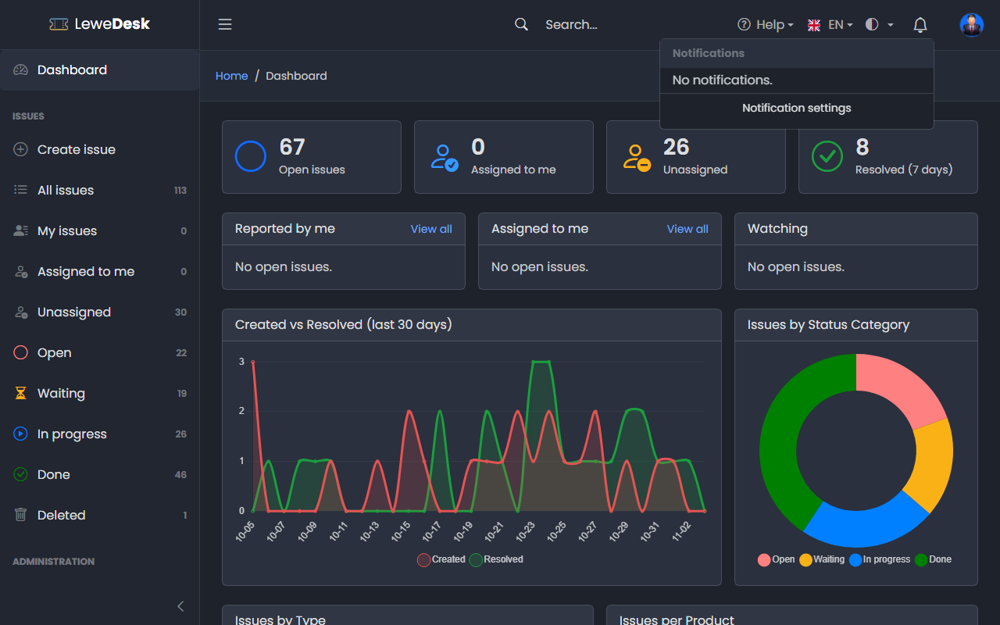
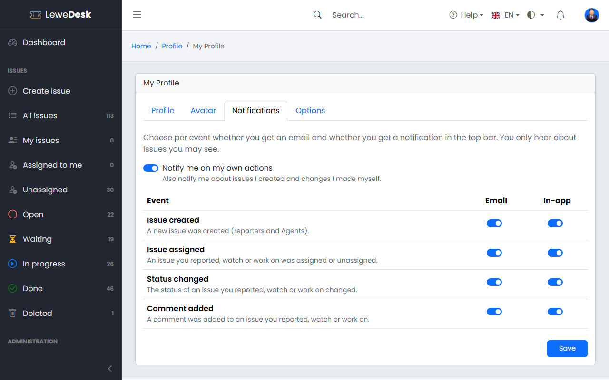

# Notifications

LeweDesk keeps you informed about what happens on your issues, in the application and by email.

## In-app notifications

<figure><figcaption></figcaption></figure>

The bell in the top bar shows a badge with the number of unread notifications. Click the bell to see the list. Click a notification to open the issue. Use **Mark all as read** to clear the badge. The browser checks for new notifications regularly (every 60 seconds by default). Old notifications are deleted automatically (after 90 days by default).

## Events

| Event          | Notifies                                  | Content                                           |
| -------------- | ----------------------------------------- | ------------------------------------------------- |
| Issue created  | Reporter, all Agents (and the support email address by email) | The issue was created                |
| Issue assigned | Reporter, assignee, watchers              | The issue was assigned to someone                 |
| Status changed | Reporter, assignee, watchers              | The status of the issue changed                   |
| Comment added  | Reporter, assignee, watchers              | A comment was added                               |

Rules:

* One action sends one combined message. _Resolve_, for example, is a comment, a status change and a resolution in one notification.
* Only users who may see the issue are notified. Internal comments only notify the support team.
* Emails are sent in the language the administrator set as default.

## Your notification settings

<figure><figcaption></figcaption></figure>

For each event you decide whether you want an **email** and/or an **in-app** notification. Both are enabled by default. Open them from **Notification settings** at the bottom of the notification list, or in your [Profile](profile.md) on the **Notifications** tab. You can also choose whether you want to be notified about your own actions.

## Watching issues

You get notifications for issues you watch. You become a watcher automatically when you report an issue, when you are assigned, and when you comment. Use **Actions** → **Watch issue** / **Unwatch issue** to change this (see [Issue Actions](issues/issue-actions.md)).
