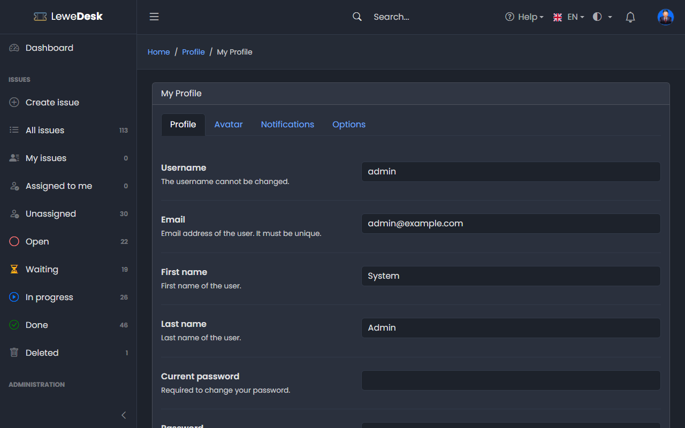
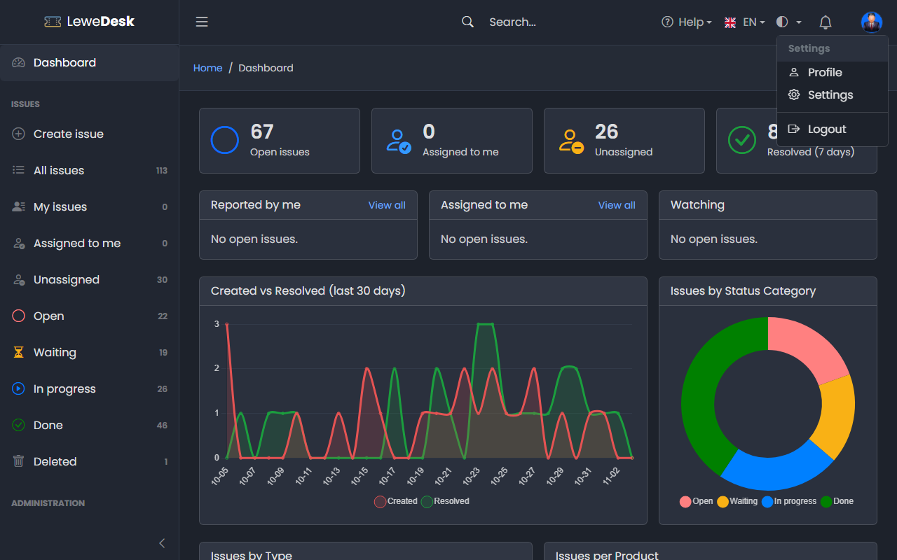
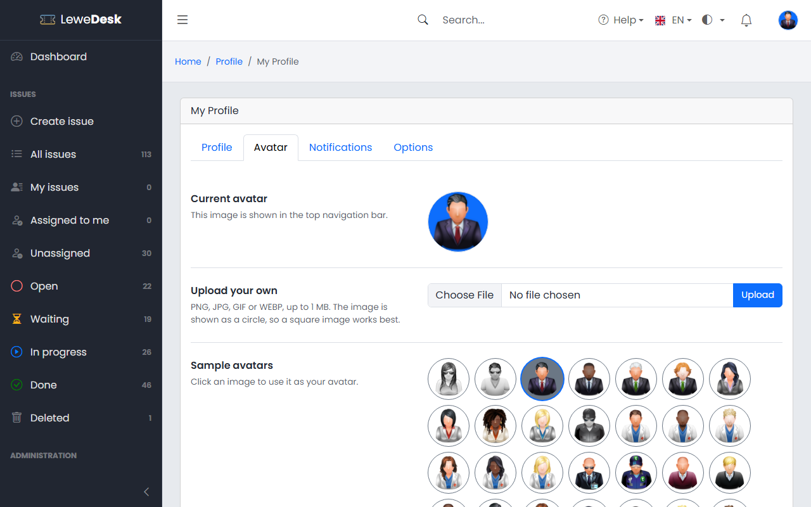
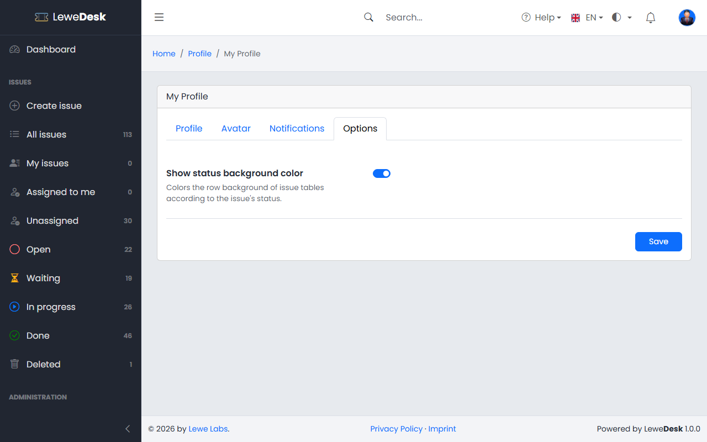

# Profile

<figure><figcaption></figcaption></figure>

Open your profile from the user menu in the top bar (click your avatar, then **Profile**).

<figure><figcaption></figcaption></figure>

## Profile tab

| Field                | Description                                                          |
| -------------------- | -------------------------------------------------------------------- |
| Username             | Your login name (cannot be changed)                                  |
| Email                | Your email address. It must be unique. Notifications are sent here.  |
| First name, Last name | Your name                                                           |
| Current password     | Required to change your password                                     |
| Password             | Enter a new password to change it (at least 4 characters). Leave empty to keep your current password. |
| Confirm new password | Repeat the new password                                              |

Click **Save**.

## Avatar tab

<figure><figcaption></figcaption></figure>

Your avatar is shown in the top bar and next to your name on issues.

* **Upload your own**: PNG, JPG, GIF or WEBP, up to 1 MB. The image is shown as a circle, so a square image works best.
* **Sample avatars**: click an image to use it.

## Notifications tab

Choose per event whether you get an email and/or an in-app notification. See [Notifications](notifications.md).

## Options tab

<figure><figcaption></figcaption></figure>

| Option                         | Description                                                                   |
| ------------------------------ | ----------------------------------------------------------------------------- |
| Show status background color   | Colors the row background of issue tables according to the issue's status     |
