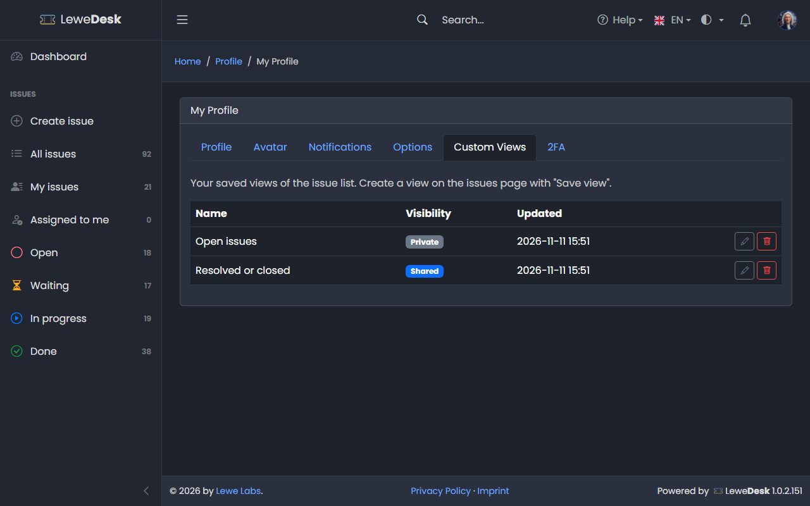
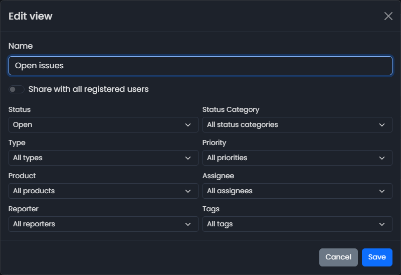

# Profile

<figure><figcaption></figcaption></figure>

Open your profile from the user menu in the top bar (click your avatar, then **Profile**).

<figure><figcaption></figcaption></figure>

## Profile tab

| Field                | Description                                                          |
| -------------------- | -------------------------------------------------------------------- |
| Username             | Your login name (cannot be changed)                                  |
| Email                | Your email address. It must be unique. Notifications are sent here.  |
| First name, Last name | Your name                                                           |
| Current password     | Required to change your password                                     |
| Password             | Enter a new password to change it (at least 4 characters). Leave empty to keep your current password. |
| Confirm new password | Repeat the new password                                              |

Click **Save**.

If your administrator uses [LDAP authentication](../administration/system/ldap-authentication.md), your password is managed outside of LeweDesk. The password fields are then replaced with a note and cannot be used. Change your password where you changed it before.

The same applies if you sign in with SSO ([OIDC authentication](../administration/system/oidc-authentication.md)). The 2FA tab is not shown then, because two factor authentication is handled by your identity provider.

## Avatar tab

<figure><figcaption></figcaption></figure>

Your avatar is shown in the top bar and next to your name on issues.

* **Upload your own**: PNG, JPG, GIF or WEBP, up to 1 MB. The image is shown as a circle, so a square image works best.
* **Sample avatars**: click an image to use it.

## Notifications tab

Choose per event whether you get an email and/or an in-app notification. See [Notifications](notifications.md).

## Custom Views tab

<figure><figcaption></figcaption></figure>

Lists the [custom views](issues/list-issues.md#custom-views) you saved in the issue list with their name, whether they are _Private_ or _Shared_, and the time of the last change.

| Button | Function                                                                                              |
| ------ | ----------------------------------------------------------------------------------------------------- |
| Edit   | Opens a dialog with the name, the **Share with all registered users** switch and the eight filters     |
| Delete | Deletes the view after a confirmation. It disappears for all users it was shared with.                |

<figure><figcaption></figcaption></figure>

If filter values of the view do not exist anymore, the edit dialog tells you and leaves them out. Click **Save** to update the view.

## 2FA tab

Set up two factor authentication with an authenticator app, or disable it again (this needs your password). See [Two Factor Authentication](two-factor-authentication.md).

## Options tab

<figure><figcaption></figcaption></figure>

| Option                         | Description                                                                   |
| ------------------------------ | ----------------------------------------------------------------------------- |
| Language                       | The language of the interface (English, German, French, Spanish) or the system default. Saved in your profile, so it applies on every browser you log in with |
| Show status background color   | Colors the row background of issue tables according to the issue's status     |
