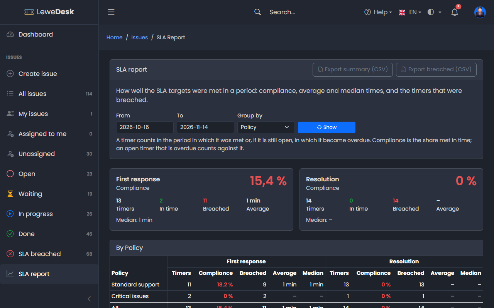
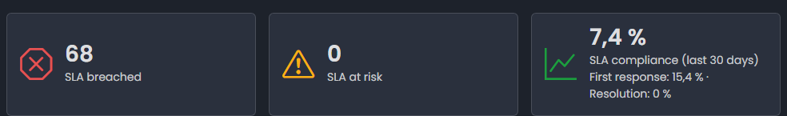

# SLA Report

<figure><figcaption></figcaption></figure>

The SLA report shows how well the targets of your [SLA policies](../administration/issues/sla-policies.md) were met in a period. Open **SLA report** in the sidebar, or click the compliance tile on the [dashboard](dashboard.md). You need the permission `view_sla`. The report only counts issues you may see.

## Period and grouping

| Field | Description |
| ----- | ----------- |
| From, To | First and last day of the period, both included, in the time zone of your browser. The default is the last 30 days. The longest period is 366 days. |
| Group by | **Policy** (default), **Product**, **Assignee** or **Priority** |

Click **Show** to update the report.

## What is counted

A timer is counted in the period in which its **outcome** happened:

* it was **met** (in time, or late), or
* it is still open and became **overdue**.

Not counted are timers that are not due yet, timers that are paused, and timers of deleted issues. The **compliance** is the share of the timers that were met in time. An open timer that is overdue counts against it, so a team that never answers its breached issues does not look good.


A timer that is met late is counted when it is met. If you answer a breached issue after the end of a period, it moves from that period to the one in which it was answered. A report of a past period can therefore change a little until all breached timers are closed.


The numbers come from what each timer stored (target, result, due time), not from the policy as it is today. Changing a policy later does not change the report. Policy is the policy the timer started with. Product, assignee and priority are the **current** values of the issue.

## Cards and table

* One card per metric (_First response_ and _Resolution_) shows the **compliance** (green from 95%, amber from 80%, red below), the number of timers, how many were in time and breached, and the **average** and **median** time that met timers needed in working time.
* The table below lists each group with both metrics side by side and a total row. Groups with the most timers come first. Issues without a product or assignee are in the group _None_.

## Breached timers

The list **Breached timers** shows each breached timer with a link to the issue, the metric, the policy, the assignee, the target, the outcome (_met_ late or still _open_) and by how much it is **over**. The newest are first, the page shows up to 500.

## Export

| Button | File |
| ------ | ---- |
| Export summary (CSV) | One row per group and metric, plus a total row |
| Export breached (CSV) | One row per breached timer, up to 20,000 rows |

The files are UTF-8 with a byte order mark, so Excel reads umlauts correctly. Cells that a spreadsheet could take for a formula are made safe with a leading apostrophe.

## Dashboard tiles

<figure><figcaption></figcaption></figure>

Users with `view_sla` see three more tiles on the [dashboard](dashboard.md):

| Tile | Meaning |
| ---- | ------- |
| SLA breached | Issues with a breached timer. Click it to open the quick view _SLA breached_. |
| SLA at risk | Issues with a timer that is at risk. Click it to open the issue list with that filter. |
| SLA compliance | Compliance of the last 30 days (30 times 24 hours back from now) with the two metrics below. Click it to open this report. |
