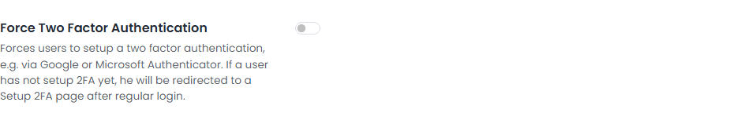
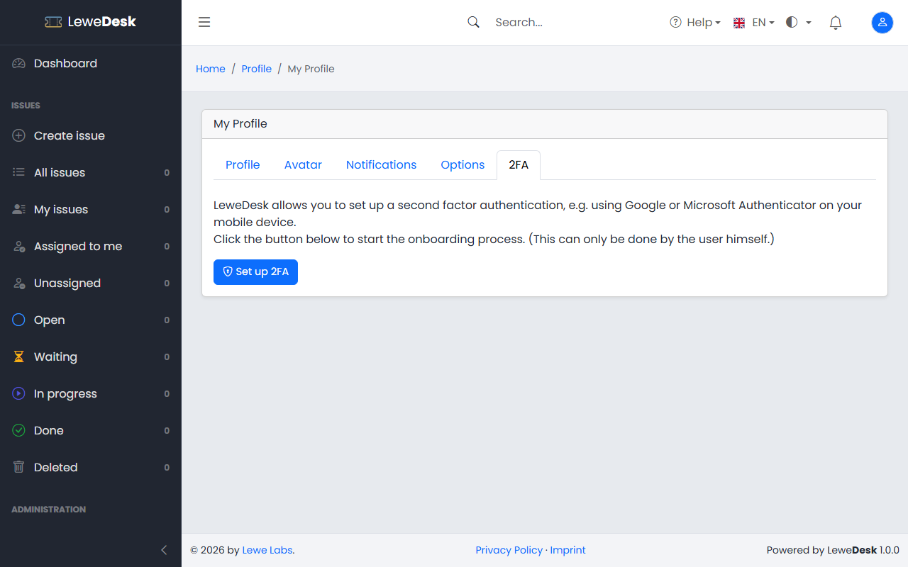
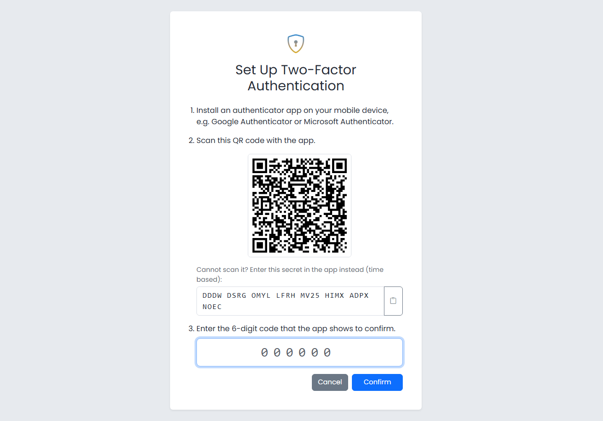
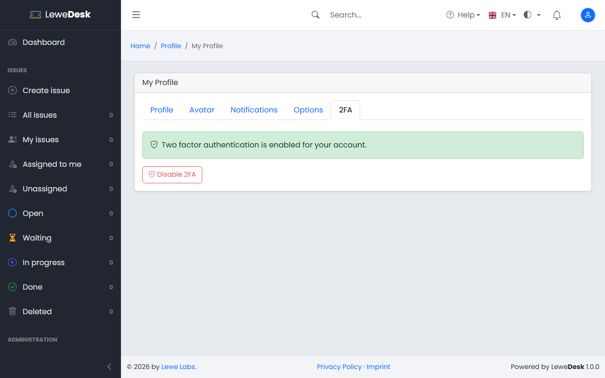
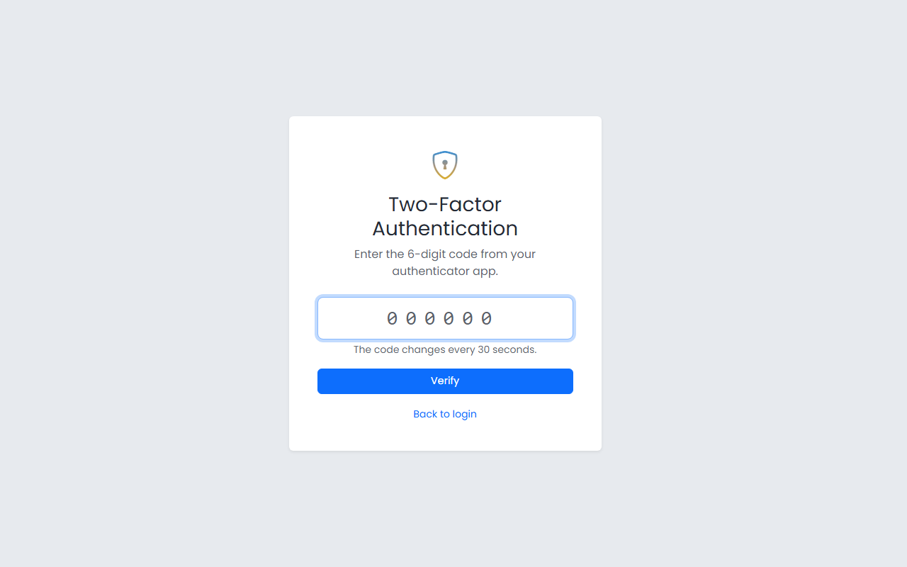
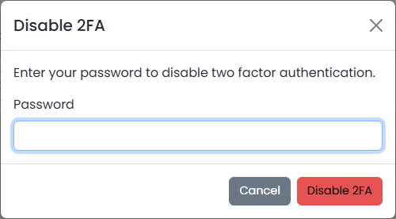
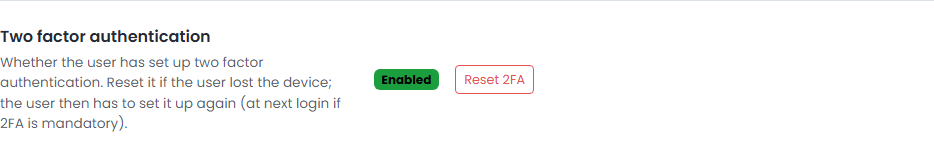

# Two Factor Authentication

Two factor authentication (2FA) protects your account with a second step at login. After your password you enter a 6-digit code from an authenticator app on your mobile device, for example Google Authenticator or Microsoft Authenticator. Somebody who learns your password still cannot log in without your device.

LeweDesk uses time based one-time passwords (TOTP, RFC 6238): the app and the server both calculate the code from a shared secret and the current time. The code changes every 30 seconds.


Note, that in order to make the TOTP based 2FA work, the server on which LeweDesk is hosted needs to be NTP synced. If that is not the case, it might lead to constant code mismatches.


## When do you have to use it?

* **Optional:** unless an administrator made 2FA mandatory, you decide yourself whether to set it up in your [Profile](profile.md).
* **Mandatory:** if an administrator switched on _Force Two Factor Authentication_ (see [Settings](../administration/system/settings.md)), you are sent to the setup page right after your password at your next login. You cannot use LeweDesk before you finished the setup. Sessions that are already open stay open.

<figure><figcaption></figcaption></figure>

## Set up 2FA

1. Install an authenticator app on your mobile device.
2. Open your [Profile](profile.md), switch to the **2FA** tab and click **Set up 2FA**. (If 2FA is mandatory for you, the setup page opens by itself after the login.)

<figure><figcaption></figcaption></figure>
3. Scan the QR code with the app. If you cannot scan it, enter the secret shown below the QR code in the app instead (choose a time based account). The QR code is created by LeweDesk itself and needs no Internet connection.

<figure><figcaption></figcaption></figure>
4. Enter the 6-digit code that the app shows and confirm. 2FA is only switched on once a correct code was entered.

<figure><figcaption></figcaption></figure>

Every time the setup page is opened, a new secret is created. Only scan the code of the page you are going to confirm.

## Log in with 2FA

1. Enter your username and password on the login page.
2. Enter the current 6-digit code from your authenticator app on the page that follows. The page submits the code as soon as you typed the sixth digit.

<figure><figcaption></figcaption></figure>

Until the code is accepted you are not logged in. A code works only once; if you just used one, wait for the next code of the app.

### Too many wrong codes

After 5 wrong codes the login is blocked for 5 minutes. The page shows a countdown. A limit per IP address (20 wrong codes in 15 minutes) also applies. Make sure the clock of your mobile device is set automatically, because a wrong time produces wrong codes.

## Disable 2FA

Open the **2FA** tab in your [Profile](profile.md), click **Disable 2FA** and enter your password. If 2FA is mandatory, a note on the tab tells you that you will have to set it up again at your next login.

<figure><figcaption></figcaption></figure>

## Lost your device?

Ask an administrator to reset your 2FA (see [Users](../administration/system/users.md)). You can then log in with your password. If 2FA is mandatory you set it up again with your new device.

<figure><figcaption></figcaption></figure>
